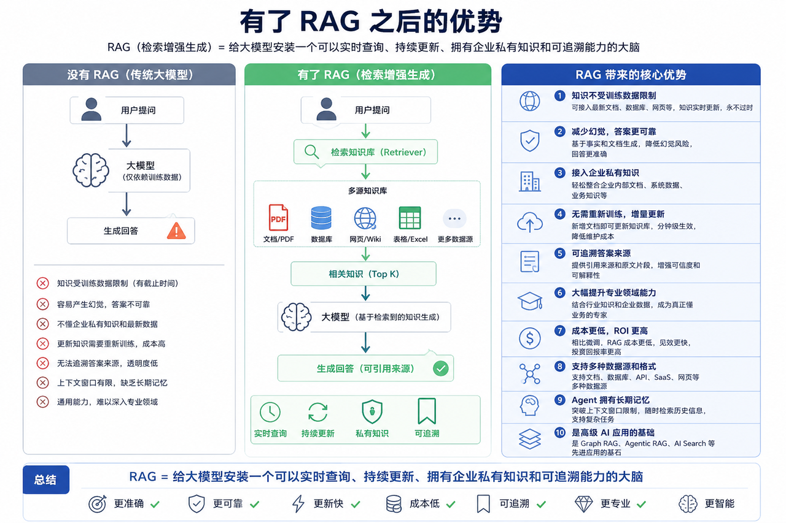
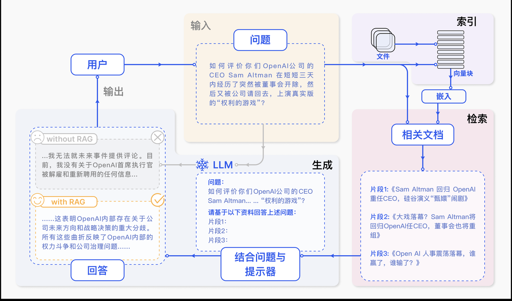
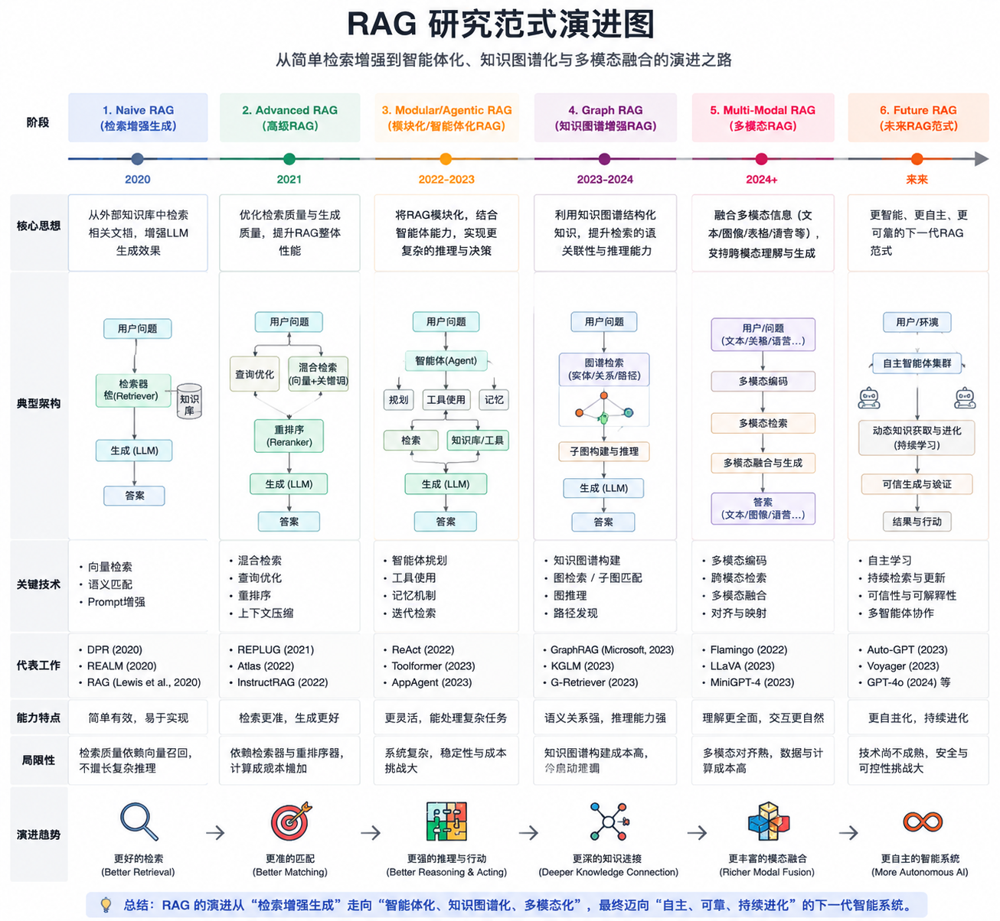
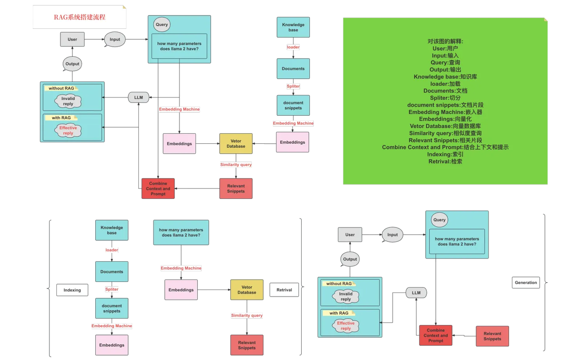
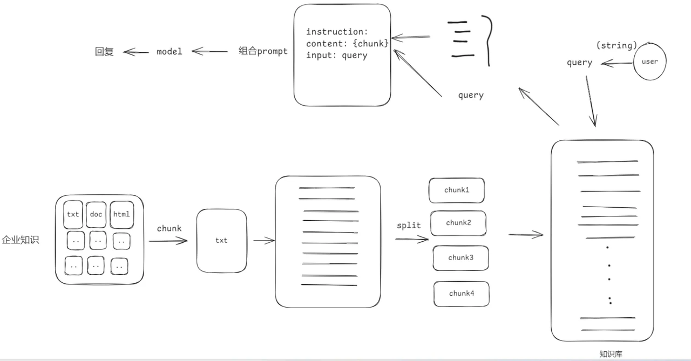
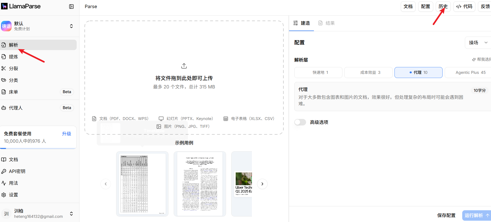

# 检索增强生成

- 幻觉: 是指模型生成的内容看似合理，但实际与事实不符、逻辑错误或缺乏真实依据的现象

  - 形成原因:
    - **训练数据噪声**：模型从海量文本中学习，但数据本身包含错误、偏见或虚构内容（例如网络谣言、小说情节），模型可能误将其视为真实知识。
    - **概率优先而非真实性**：模型目标是生成“最符合上下文概率分布”的文本，而非追求事实正确性。当缺乏明确答案时，模型倾向于用高频词汇或合理句式“填补空白”(做填词游戏)。

- LLM知识更新缓慢

- ##### LLM对领域知识的理解有限

  - 在一些较为浅显的领域，大型语言模型可能通过之前的大量训练数据获得了相应的能力。但当涉及到更深层次的专业领域时，这些模型往往会出现所谓的“幻觉”问题，即生成的信息可能偏离事实或专业知识的真实性。
  - 形成原因:
    - 训练数据的覆盖广度与深度矛盾(**广度优先** ):LLM的训练数据覆盖全网公开文本（书籍、网页、论文等），但**领域知识往往分布稀疏**


 **RAG的初衷是为了增强大模型的事实性，时效性，减少幻觉，引入专业知识优化生成回复**


## RAG的概念

- RAG（Retrieval Augmented Generation）顾名思义，通过检索外部数据，增强大模型的生成效果。
- 最早提及RAG论文:https://arxiv.org/pdf/2005.11401
- 类比:你可以把这个过程想象成开卷考试。让LLM先翻书，再回答问题。
- 举例: 我想询问LLM有关于我公司内部的请假流程它肯定不知道,但是我把公司的员工手册先给它看,当我在询问的时候他就会知道




RAG**系统工作流程图解**



可以看出，它主要包括三个步骤：

1. **索引化：**将文档切分成片段，再编码为向量，存储在向量数据库里。
2. **检索：**检索到与问题相似度最高的top k 的片段。
3. **生成：**将原始问题和检索得到的“块”都作为LLM的输入，令其生成最终的回答。


RAG的研究范式一直在持续演进，我们将其发展过程分为三个阶段：朴素RAG（Naive RAG）、高级RAG（Advanced RAG）和模块化RAG（Modular RAG），如图所示 




# Naive RAG

Naive RAG遵循一个传统的处理流程，包括索引、检索和生成三个阶段





### 文档分块



**分块策略:**

- 按照句子来切分
- 按照字符数来切分
- 按固定字符数 结合overlapping window

##### 1.1 **按照句子来切分**

```Python
# -*- encoding:utf-8 -*-
import re

text = "自然语言处理（NLP），作为计算机科学、人工智能与语言学的交融之地，致力于赋予计算机解析和处理人类语言的能力。在这个领域，机器学习发挥着至关重要的作用。利用多样的算法，机器得以分析、领会乃至创造我们所理解的语言。从机器翻译到情感分析，从自动摘要到实体识别，NLP的应用已遍布各个领域。随着深度学习技术的飞速进步，NLP的精确度与效能均实现了巨大飞跃。如今，部分尖端的NLP系统甚至能够处理复杂的语言理解任务，如问答系统、语音识别和对话系统等。NLP的研究推进不仅优化了人机交流，也对提升机器的自主性和智能水平起到了关键作用。"

# 正则表达式匹配中文句子结束的标点符号
sentences = re.split(r'(。|？|！|\..\..)', text)

# 重新组合句子和结尾的标点符号
chunks = []
for sentence, punctuation in zip(sentences[::2], sentences[1::2]):
    chunks.append(sentence + (punctuation if punctuation else ''))

print(chunks)
for i, chunk in enumerate(chunks):
    print(f"块 {i + 1}: {len(chunk)}: {chunk}")
```

##### 1.2 **按照固定字符数切分**

```Python
# -*- encoding:utf-8 -*-

def split_by_fixed_char_count(text, count):
    chunks = []
    for i in range(0, len(text), count):
         chunks.append(text[i:i + count])
    return chunks


text = "自然语言处理（NLP），作为计算机科学、人工智能与语言学的交融之地，致力于赋予计算机解析和处理人类语言的能力。在这个领域，机器学习发挥着至关重要的作用。利用多样的算法，机器得以分析、领会乃至创造我们所理解的语言。从机器翻译到情感分析，从自动摘要到实体识别，NLP的应用已遍布各个领域。随着深度学习技术的飞速进步，NLP的精确度与效能均实现了巨大飞跃。如今，部分尖端的NLP系统甚至能够处理复杂的语言理解任务，如问答系统、语音识别和对话系统等。NLP的研究推进不仅优化了人机交流，也对提升机器的自主性和智能水平起到了关键作用。"

# 假设我们按照每100个字符来切分文本
chunks = split_by_fixed_char_count(text, 100)
for i, chunk in enumerate(chunks):
    print(f"块 {i + 1}: {len(chunk)}: {chunk}")
```

##### 1.3 **按固定字符数 结合overlapping window**

```python
# -*- encoding:utf-8 -*-
def sliding_window_chunks(text, chunk_size, stride):
    chunks = []
    for i in range(0, len(text), stride):
        chunks.append(text[i:i + chunk_size])
    return chunks


text = "自然语言处理（NLP），作为计算机科学、人工智能与语言学的交融之地，致力于赋予计算机解析和处理人类语言的能力。在这个领域，机器学习发挥着至关重要的作用。利用多样的算法，机器得以分析、领会乃至创造我们所理解的语言。从机器翻译到情感分析，从自动摘要到实体识别，NLP的应用已遍布各个领域。随着深度学习技术的飞速进步，NLP的精确度与效能均实现了巨大飞跃。如今，部分尖端的NLP系统甚至能够处理复杂的语言理解任务，如问答系统、语音识别和对话系统等。NLP的研究推进不仅优化了人机交流，也对提升机器的自主性和智能水平起到了关键作用。"

chunks = sliding_window_chunks(text, 100, 50)  # 100个字符的块，步长为50

for i, chunk in enumerate(chunks):
    print(f"块 {i + 1}: {len(chunk)}: {chunk}")
```

# 向量与Embedding

#### 向量

在数学中，向量（也称为欧几里得向量、几何向量），指具有大小（magnitude）和方向的量。它可以形象化地表示为带箭头的线段。箭头所指：代表向量的方向；线段长度：代表向量的大小。

1. 将文本转成一组浮点数：每个下标 `i`，对应一个维度
2. 整个数组对应一个 `n` 维空间的一个点，即**文本向量**又叫 Embeddings
3. 向量之间可以计算距离，距离远近对应**语义相似度**大小

- 在计算机中我们用数组来表述向量

```python
import numpy as np

v = np.array([3, 4])  # 数组表示向量
magnitude = np.linalg.norm(v)  # 计算大小
unit_vector = v / magnitude    # 计算单位向量（方向）
angle = np.arctan2(v[1], v[0]) * 180 / np.pi  # 角度（度）

print(f"大小: {magnitude}")
print(f"单位向量 (方向): {unit_vector}")
print(f"与x轴角度: {angle:.1f}°")
```

#### AI中数据的本质

> 在计算机当中所有数据的存储都是二进制,不管是图片还是文字,都是以二进制的内容进行存储的


#### 表示学习

**表示学习**:通过学习算法自动地从原始数据中学习到一种表示形式或特征表示，该表示形式能够更好地表达数据的重要特征和结构。表示学习的目标是将输人数据转换为具有良好表示能力的特征空间，使得在该空间中的数据具有更好的可分性、可解释性或推理能力

- 将数据转换成低维的内容,并且向量直接的关系非常清晰


#### Embedding

- 嵌入:表示学习的一种形式，通常用于将高维数据映射到低维空间中的表示形式。嵌入可以是词嵌入、图像嵌入、图嵌入等。例如，在自然语言处理中，词嵌入将词语映射到低维向量空间，以捕捉词语之间的语义和句法关系。在图像处理中，图像嵌入将图像映射到低维向量空间，以表示图像的视觉特征。
- 可以理解为表示学习是成为翻译官的过程, 嵌入是成为翻译官之后把内容翻译成正确的结果

##### 4.1 转换代码

- 如何才能把字符转换成向量?
- 我们在使用的时候不需要过多关注我们都是使用现成的转换工具

```Python
from openai import OpenAI
from dotenv import load_dotenv
import os

load_dotenv()
client = OpenAI(api_key=os.getenv("api_key"), base_url=os.getenv("base_url"))


def get_embeddings(texts, model="text-embedding-v1"):
    #  texts 是一个包含要获取嵌入表示的文本的列表，
    #  model 则是用来指定要使用的模型的名称
    #  生成文本的嵌入表示。结果存储在data中。
    data = client.embeddings.create(input=texts, model=model).data
    # print(data)
    # 返回了一个包含所有嵌入表示的列表
    return [x.embedding for x in data]


test_query = ["我爱你"]

vec = get_embeddings(test_query)
print(vec)
#  "我爱你" 文本嵌入表示的列表。
print(len(vec))
#  "我爱你" 文本的嵌入表示。
print(vec[0])
#  "我爱你" 文本的嵌入表示的维度。3072
print(len(vec[0]))
```

##### 4.2 向量模型本地部署

- Huggingface：https://huggingface.co/
- Hugging Face 是一个专注于 **机器学习**（尤其是自然语言处理，NLP）的**开源平台和社区**，提供从模型开发、训练、部署到共享的一站式工具和资源
- 国内的镜像地址：https://hf-mirror.com/
- 魔搭社区：https://www.modelscope.cn/my/overview
- 在网址中找到自己需要的文本向量模型

```python
# 模型下载
from modelscope import snapshot_download
# pip install modelscope
model_dir = snapshot_download("BAAI/bge-large-zh-v1.5", cache_dir="D:\LLM\Local_model")
```

- 使用本地的向量模型进行向量化

```Python
# pip install sentence-transformers
# 用来加载模型,并使用模型生成向量
from sentence_transformers import SentenceTransformer

model_path = r"D:\LLM\Local_model\BAAI\bge-large-zh-v1___5"  # 替换为实际路径
model = SentenceTransformer(model_path)

sentences = [
    "你好",
    '你'
]

# 生成向量（默认返回numpy数组）
embeddings = model.encode(sentences)
print(embeddings)
print(embeddings.shape)  # 输出: (2, 1024)  （维度取决于模型）
```


# llamaindex

## 嵌入模型

### 在线模型

``` python
pip install llama-index-embeddings-dashscope # 下载对应的标准接口


embed_model = DashScopeEmbedding(
    model_name="text-embedding-v3",
    api_key=os.getenv("DASHSCOPE_API_KEY")
)
```

### 离线模型

安装模块

``` shell
pip install sentence_transformers

from modelscope import snapshot_download

model_dir = snapshot_download('BAAI/bge-m3', cache_dir=r"D:\LLM\Local_model")
```

示例

``` python
from pathlib import Path
from typing import ClassVar

from pydantic_settings import BaseSettings, SettingsConfigDict

from llama_index.embeddings.dashscope import DashScopeEmbedding
from llama_index.embeddings.huggingface import HuggingFaceEmbedding


class AppConfigSettings(BaseSettings):
    """应用配置"""
    # 基础目录
    BASE_DIR: ClassVar[Path] = Path(__file__).resolve().parent

    # 阿里百炼 key
    BAILIAN_OPEN_AI_KEY: str
    # 阿里百炼 base url
    BAILIAN_OPEN_AI_BASE_URL: str

    # 本地嵌入模型路径
    LOCAL_EMB_BAILIAN_LLN_URL: str # 维度 1024
    # 重排嵌入模型路径
    LOCAL_EMB_BAILIAN_LLN_RERANKER_URL: str

    model_config = SettingsConfigDict(
        env_file=Path(__file__).resolve().parent / ".env",  # 指定文件（相对于当前文件路径）
        env_file_encoding="utf-8",
        extra="ignore",  # 忽略 .env 里多余的变量
        case_sensitive=True,  # 推荐保持默认 True，让字段名和 .env 完全一致
    )

    def get_embedding_model(self, model: str | None = None, **model_kwargs) -> DashScopeEmbedding:
        """获取DashScope嵌入模型"""
        # qwen3.7-text-embedding-flash qwen3.7-text-embedding
        # qwen3.7-text-rerank qwen3-vl-embedding
        embed_model = DashScopeEmbedding(model=model or "qwen3.7-text-embedding-flash", api_key=self.BAILIAN_OPEN_AI_KEY,
                                         **model_kwargs)
        return embed_model

    def get_local_embedding_model(self, **model_kwargs) -> HuggingFaceEmbedding:
        """获取本地嵌入模型"""
        embed_model = HuggingFaceEmbedding(model_name=self.LOCAL_EMB_BAILIAN_LLN_URL, **model_kwargs)
        return embed_model


app_settings = AppConfigSettings()

```

## 数据清洗

文档处理，加载器，分割器，存储，创建索引，管道，检索器，响应器，查询引擎，记忆，评估，


## 文档处理

- 文档加载是 LlamaIndex 构建 RAG 应用的第一步，其核心是将外部数据转换为 LlamaIndex 可处理的 Document 对象。

- **Document:** LlamaIndex 中的基本数据容器。包含 text（主要文本内容）和 metadata（元数据，如文件名、页码、创建时间、自定义标签等）。 Document 可以从加载器自动生成，也可以手动构造，同时也会根据**文档内容+元信息**生成 **hash**。
- **Node**（节点）：Document 被切分后的“原子块”。后续索引（Index）实际上是对 Node 进行 Embedding 和存储。Node 继承自 Document，并额外带有 relationships（父子、上下级关系等）。
- **Reader**（加载器）：负责从不同数据源读取并解析成 Document 的类。所有 Reader 都继承自 BaseReader。
  - 各个加载器地址:https://developers.llamaindex.ai/python/framework-api-reference/readers/


### 文档加载器

加载文档，也可以自定义处理


#### SimpleDirectoryReader

- SimpleDirectoryReader 是官方最推荐的通用文件加载器，几乎所有入门和中型项目都从它开始。

```python
from llama_index.core import SimpleDirectoryReader


def parser():
    pass

reader = SimpleDirectoryReader(
    input_dir="./data",                    # 文件夹路径
    required_exts=[".pdf", ".docx", ".md", ".txt"],  # 只加载指定类型
    recursive=True,                        # 递归子文件夹
    exclude_hidden=True,                   # 排除隐藏文件
    exclude_empty=True,                    # 排除空文件
    filename_as_id=True,                   # 使用文件名作为 doc_id
    file_extractor={".pdf": parser},       # 自定义 PDF 解析器
    exclude=['111.txt'],                   # 忽略某个文件
    num_files_limit=1000,                  # 最大文件数
)

# show_progress 显示精度条  num_workers 鬓发数
documents = reader.load_data(show_progress=True, num_workers=3)
print(documents)
print(f"成功加载 {len(documents)} 个 Document 对象")
```

- 迭代处理-`iter_data`

```python
from llama_index.core import SimpleDirectoryReader


def parser():
    pass

reader = SimpleDirectoryReader(
    input_dir="./data",                    # 文件夹路径
)

# 迭代处理   避免全部文档一次性加载
data = reader.iter_data(show_progress=True)
for i in data:
    print("*"*100)
    print(i)
```

- **Document**对象
  - id_ : 文档的唯一标识符
  - text : 文档的主要文本内容
  - metadata : 一个字典（Dict[str, Any]），存放文档的元数据信息。
    - file_path：文件的完整路径（包含文件名）
    - file_name：文件名（含后缀）
    - file_type：文件 MIME 类型（如 application/pdf、text/plain）
    - file_size：文件大小（字节数）
    - creation_date、last_modified_date、last_accessed_date：文件的创建、修改、访问时间
    - 你可以手动添加自定义元数据，例如 doc.metadata["category"] = "AI公司" 或 doc.metadata["language"] = "zh"。
  - **embedding** : 该文档的向量嵌入 , 在单纯加载阶段（load_data()）通常为 None，只有在构建索引时才会生成并填充。
  - **relationships** : 用于记录节点之间的关系(图关系)
  - **excluded_embed_metadata_keys** : 列表，在生成向量嵌入的时候，告诉 LlamaIndex 这些 metadata 字段不要放进向量里(避免不必要的数据进行检索干扰)
  
  通过 lamaindex 的方式框架默认会帮忙加入一些创建好的关系和元信息；
  
  ``` python
  documents = SimpleDirectoryReader(
      input_files=["./RAG-data/xxx.md"],
  ).load_data()
  
  parse = SentenceSplitter(
      chunk_size=512,
      chunk_overlap=50
  )
  # documents 文档列表
  nodes = parse.get_nodes_from_documents(documents=documents) # 切割后的节点
  
  for node in nodes:
      print(node.model_dump_json(indent=2))
  ```
  
  其中的节点
  
  ``` json
  {
    "id_": "1b91b7a4-7969-471d-aabb-6189f947411f",
    "embedding": null,
    "metadata": {
      "file_path": "RAG-data/xxx.md",
      "file_name": "xxx.md",
      "file_type": "text/markdown",
      "file_size": 17346,
      "creation_date": "2026-10-07",
      "last_modified_date": "2026-10-07"
    },
    "excluded_embed_metadata_keys": [
      "file_name",
      "file_type",
      "file_size",
      "creation_date",
      "last_modified_date",
      "last_accessed_date"
    ],
    "excluded_llm_metadata_keys": [
      "file_name",
      "file_type",
      "file_size",
      "creation_date",
      "last_modified_date",
      "last_accessed_date"
    ],
    "relationships": {
      "1": {
        "node_id": "06d924a5-164a-4a33-9b72-720ed93d896d",
        "node_type": "4",
        "metadata": {
          "file_path": "RAG-data/xxx.md",
          "file_name": "xxx.md",
          "file_type": "text/markdown",
          "file_size": 17346,
          "creation_date": "2026-10-07",
          "last_modified_date": "2026-10-07"
        },
        "hash": "24a9c73576d81f4264956d1a39a2471c04946e6e6c03d815b973bbe2305d89d6",
        "class_name": "RelatedNodeInfo"
      },
      "2": {
        "node_id": "53320c91-4c63-48eb-af8a-a1663cec11df",
        "node_type": "1",
        "metadata": {
          "file_path": "RAG-data/xxx.md",
          "file_name": "xxx.md",
          "file_type": "text/markdown",
          "file_size": 17346,
          "creation_date": "2026-10-07",
          "last_modified_date": "2026-10-07"
        },
        "hash": "3c933ef4cbe952812a276450888ba4585d25837c0653c27bfb4a14f3786b300b",
        "class_name": "RelatedNodeInfo"
      }
    },
    "metadata_template": "{key}: {value}",
    "metadata_separator": "\n",
    "text": "题内容内容内容内容内容标题内容内容内容内容内容\n\n### 测试标题10 第 2 标题 第 3 标题 4\n内容 3 标题内容内容内容内容内容标题内容内容内容内容内容标题内容内容内容内容内容标题内容内容内容内容内容标题内容内容内容内容内容\n标题内容内容内容内容内容标题内容内容内容内容内容标题内容内容内容内容内容标题内容内容内容内容内容\n标题内容内容内容内容内容标题内容内容内容内容内容标题内容内容内容内容内容\n\n\n### 测试标题10 第 2 标题 第 3 标题 5\n内容 3 标题内容内容内容内容内容标题内容内容",
    "mimetype": "text/plain",
    "start_char_idx": 5874,
    "end_char_idx": 6130,
    "text_template": "{metadata_str}\n\n{content}",
    "class_name": "TextNode"
  }
  ```
  
  大部分的字段会继承于Document ，并会自动 的关联节点之间的关系；

##### 2. 文档数据加载

**llama-index-readers-file** : LlamaIndex 中最基础、最重要的文件读取集成包

提供给 **SimpleDirectoryReader** 的一个“文件处理插件集合”

```Plaintext
pip install llama-index-readers-file # 下载方式
```

安装后，你可以直接从 llama_index.readers.file 导入以下常用 Reader：

| 文件类型    | Reader 类名                 | 说明                                 | 推荐使用场景 |
| ----------- | --------------------------- | ------------------------------------ | ------------ |
| PDF         | PDFReader / PyMuPDFReader   | 读取 PDF（支持文本层或 OCR）         | 普通 PDF     |
| Word        | DocxReader                  | 读取 .docx 文件                      | Word 文档    |
| PowerPoint  | PptxReader                  | 读取 .pptx 文件                      | 演示文稿     |
| Markdown    | MarkdownReader              | 读取 .md 文件（保留格式）            | 笔记、文档   |
| CSV / Excel | CSVReader、PandasCSVReader  | 结构化表格数据                       | 数据表格     |
| Jupyter     | IPYNBReader                 | 读取 .ipynb 文件                     | 代码笔记本   |
| 纯文本      | TextFileReader / FlatReader | 读取 .txt 等纯文本                   | 简单文本     |
| 图像        | ImageReader                 | 读取图片（可结合多模态模型提取文字） | 截图、照片   |
| HTML        | HTMLReader                  | 读取 .html 文件                      | 网页保存文件 |

- 使用方式

```python
from llama_index.readers.file import PDFReader, DocxReader
from llama_index.core import SimpleDirectoryReader

file_extractor = {
    ".pdf": PDFReader(),   # 处理pdf文件 以页的形式加载成Document
    ".docx": DocxReader(), # 处理docx文件 整个文件是一个Document
}

documents = SimpleDirectoryReader(
    input_dir="./data",
    required_exts=[".pdf", ".docx", ".md", ".txt"],
    file_extractor=file_extractor,
    recursive=True,
    exclude_empty=True,
).load_data()

for doc in documents:
    print(repr(doc))
```

##### 3. 网页数据加载

- llama-index-readers-web : 提供多种 Web Reader（网页加载器），让开发者能轻松从网页或网站抓取内容。
- https://developers.llamaindex.ai/python/framework-api-reference/readers/web/#llama_index.readers.web.FireCrawlWebReader

```python
pip install llama-index-readers-web
from llama_index.readers.web import FireCrawlWebReader
import os
from dotenv import load_dotenv

load_dotenv()

reader = FireCrawlWebReader(
    api_key=os.getenv("FIRECRAWL_API_KEY"),   # 需要去 https://firecrawl.dev 免费注册获取
    mode="scrape",          # "scrape" 单页 | "crawl" 整站爬取
)

# 加载单个或多个 URL
documents = reader.load_data("https://careers.tencent.com/jobdesc.html?postId=2001186280909725696")

print(documents[0].text)
```

#### LlamaParse 高精度文档解析

前面介绍的本地加载器（`PDFReader`、`DocxReader` 等）在处理**结构简单、文字层完整**的文档时表现良好，但在以下场景中会遇到明显瓶颈：

| 场景                               | 本地加载器的问题                 | LlamaParse 的解决方案                |
| ---------------------------------- | -------------------------------- | ------------------------------------ |
| **扫描件 / 图片型 PDF**            | 无法提取文字，返回空内容         | 内置 OCR 引擎，精准识别文字          |
| **复杂表格**                       | 表格结构丢失，变成混乱的纯文本   | 保留表格结构，输出为 Markdown 表格   |
| **多栏排版**                       | 文字顺序错乱，左右栏内容混在一起 | 智能识别版面布局，按正确阅读顺序输出 |
| **嵌套结构（标题层级、列表嵌套）** | 层级关系丢失                     | 保留文档的层级结构（Markdown 格式）  |
| **图表、公式**                     | 直接忽略或乱码                   | 提取图表描述，识别数学公式           |
| **混合内容（文字+图片+表格穿插）** | 只能提取部分文字                 | 完整解析所有元素并按顺序排列         |

- 本地加载器解决的是"能不能读"的问题，LlamaParse 解决的是"读得好不好"的问题。

##### LlamaParse 简介

`LlamaParse` 是 LlamaIndex 官方推出的**云端高精度文档解析引擎**，专注于复杂文档的 OCR 和结构化提取。

**核心特点**：

- **云端处理**：文档上传到 LlamaCloud 服务器解析，不占用本地资源
- **高精度 OCR**：基于先进的视觉模型，识别准确率远超传统 OCR
- **结构化输出**：将文档解析为干净的 **Markdown 格式**，保留标题、表格、列表、代码块等结构
- **多语言支持**：支持中文、英文、日文等多种语言
- **与 LlamaIndex 无缝集成**：解析结果直接就是 `Document` 对象，可以直接进入后续的索引构建流程
- **支持多种文件格式**：PDF、DOCX、PPTX、XLSX、图片（PNG/JPG）等

**官方网站**：https://cloud.llamaindex.ai/

使用 LlamaParse 需要先注册 LlamaCloud 账号并获取 API Key：

**步骤：**

- 访问 https://cloud.llamaindex.ai/ ，点击注册（支持 Google / GitHub 账号登录）
- 注册成功后，进入控制台，在 **API Keys** 页面生成一个 API Key
- 免费账户每月有一定的免费解析额度（具体额度以官网最新公告为准）

##### 安装与基础用法

文档:https://developers.llamaindex.ai/llamaparse/?gl=1*oruz34*_gcl_au*MTY2MjAwMjExLjE3NzQ0NDE2OTM.*_ga*NjczMjQ2ODgwLjE3NzQ0NDE2OTM.*_ga_09S9Q9J2EP*czE3NzcyMDg4MzgkbzMyJGcxJHQxNzc3MjEwMTEwJGo0OCRsMCRoMTI0NjMwNzkwMg..

`llama-parse` 是一个独立的包，不包含在 `llama-index` 主包中，需要单独安装。

```Plaintext
pip install llama-cloud>=2.1
```

> **注意**：旧版的 `llama-parse` 包已废弃，官方已将 LlamaParse 整合进统一的 `llama-cloud` SDK 中。本课件全部使用新版 `llama-cloud` SDK 编写。

- 调用步骤

```Plaintext
第一步：上传文件 → client.files.create()
         ↓
第二步：解析文件 → client.parsing.parse()
         ↓
       获取结果（Markdown 格式的页面列表）
```

- 基础使用

```python
import os
from dotenv import load_dotenv
from llama_cloud import LlamaCloud

load_dotenv()


# 初始化链接
client = LlamaCloud(api_key=os.getenv('LLAMA_CLOUD_API_KEY'))

# 第一步：上传文件
file = client.files.create(
    file="./data/财务管理文档.pdf",   # 本地文件路径
    purpose="parse",              # 固定写法，表示用于解析
)

print(f"文件上传成功，file_id: {file.id}")

# 第二步：解析文件
result = client.parsing.parse(
    file_id=file.id,
    tier="agentic",        # 解析层级（推荐 agentic，最高精度）
    version="latest",      # 使用最新版本的解析引擎
    expand=["markdown"],   # 返回 Markdown 格式
)

# print(result)

with open('财务管理文档.md', 'a', encoding='utf-8')as f:
    # 第三步：获取解析结果
    for i, page in enumerate(result.markdown.pages):
        print(f"========== 第 {i+1} 页 ==========")
        print(repr(page.markdown))
        f.write(page.markdown)
        # print()
```

###### 1. create

- create做的事情

```Plaintext
你的本地文件  
构造 HTTP 请求
     - 把你的文件封装成 multipart/form-data 格式
     - 附带上 purpose、project_id 等参数
发送到 LlamaCloud 服务器 
     - POST 请求到 LlamaCloud 的 files API 端点
服务端接收并存储文件  
     - 存到 LlamaCloud 的文件存储系统
     - 给文件分配一个唯一 ID
返回一个 FileCreateResponse 对象
       - 包含文件的 id、name、status 等元信息
```

###### 2. parse

**逻辑拆解:**

```Plaintext
1. 下发解析指令
        客户端发送 file_id 和配置参数（如 tier="agentic"）。
        触发 LlamaCloud 服务端的任务队列。
2. 多模态 AI 引擎介入（核心步骤）
        视觉布局分析（Layout Analysis）： 引擎像人眼一样扫描页面，识别哪里是标题、哪里是正文、哪里是表格。
        OCR 识别： 如果是扫描件或 PDF 中的图片文字，调用高精度 OCR 进行字符转录。
        逻辑重组： 识别表格的行列结构，将复杂的层级关系（如嵌套列表）转换为对应的 Markdown 语法。
3. Agentic 智能增强（若指定 tier="agentic"）
        引擎会反复核对解析结果，如果遇到模糊的公式或复杂的财务报表，会启动“自我修正”机制，确保数据的准确性。
4. 数据格式化生成
        根据 expand=["markdown"] 参数，将解析出的结构化信息包装成标准的 Markdown 字符串。
        按照原始文件的分页信息，切分成 pages 列表。
5. 返回 Result 对象
        返回一个包含执行状态、解析内容（Markdown/Text/JSON）的复合对象。
```

- 上传文件位置




### **创建文档**

手动创建文档

``` python
from llama_index.core import Document

document = Document(
    text="This is a test document.",  # type: ignore
    metadata={"author": "test", "header": "header_01", "category": "test_category"}
)
print(document.id_) # 一个随机 UUID，可以显示的传递，不传递的话，会每次创建都自动创建一个
print(document.text) # 文档文本
print(document.metadata) # 文档自定义的元信息
print(document.hash) # 文档hash
```

### Markdown

目前针对切割成chunks比较合适；

llamaIndex提供的解析器，额，都不咋地，都是只能处理一些简单的正文内容，稍微复杂点的基本上处理不了或者乱了布局等等；


## 文本切割器(核心)

### 定义节点

- 节点**(Node)**表示源文档 (Document) 的“块”，可以是文本块、图像块或其他。与文档类似，节点包含元数据以及与其他节点的关系信息。
- 节点是 LlamaIndex 中的高级类。可以选择直接定义节点及其所有属性。也可以选择对应的`NodeParser`类将源文档“解析”为节点。默认情况下，每个从文档派生的节点都会从该文档继承相同的元数据（例如，文档中记录的“file_name”会传播到每个节点）。

- 节点类型

| 节点类型      | 用途       | 常见场景                                                  |
| ------------- | ---------- | --------------------------------------------------------- |
| **TextNode**  | 文本片段   | 基础 RAG，最常用                                          |
| **ImageNode** | 图像数据   | 多模态 RAG                                                |
| **IndexNode** | 指向子索引 | 递归检索、摘要+细节检索(文档多的时候先把整个文档规整起来) |

- 节点数据内容

| 属性                           | 默认值                         | 说明                         |
| ------------------------------ | ------------------------------ | ---------------------------- |
| `id_`                          | UUID                           | 节点唯一ID，切割后会自动创建 |
| `text`                         | `""`                           | 文本内容                     |
| `mimetype`                     | `"text/plain"`                 | MIME类型                     |
| `embedding`                    | `None`                         | 向量嵌入                     |
| `start_char_idx`               | `None`                         | 起始字符位置                 |
| `end_char_idx`                 | `None`                         | 结束字符位置                 |
| `relationships`                | `{}`                           | 节点关系                     |
| `metadata`                     | `{}`                           | 元数据                       |
| `metadata_seperator`           | `"\n"`                         | 元数据分隔符                 |
| `metadata_template`            | `"{key}: {value}"`             | 元数据格式                   |
| `text_template`                | `{metadata_str}\n\n{content}"` | 文本格式                     |
| `excluded_embed_metadata_keys` | `[]`                           | 嵌入时排除的metadata         |
| `excluded_llm_metadata_keys`   | `[]`                           | 送LLM时排除的metadata        |

- **手动构建节点**

  ``` python
  from llama_index.core.schema import TextNode, RelatedNodeInfo
  
  node1 = TextNode(text="deepseek", id_="node_1", metadata={"type": "text", "order": "1"})  # 节点1：文本内容"deepseek"
      node2 = TextNode(text="chatgpt", id_="node_2", metadata={"type": "text", "order": "1"})  # 节点2：文本内容"chatgpt"
  
  # 关联
  def link_bidirectional(a: TextNode, b: TextNode, a_note: str, b_note: str):
      a.relationships[NodeRelationship.NEXT] = RelatedNodeInfo(
          node_id=b.node_id,  # 关联的目标节点ID（b的唯一标识）
          metadata={"desc": a_note}  # 关系的描述元数据，方便后续追溯
      )
      b.relationships[NodeRelationship.PREVIOUS] = RelatedNodeInfo(
          node_id=a.node_id,  # 关联的目标节点ID
          metadata={"desc": b_note}  # 关系的描述元数据
      )
  
      # NodeRelationship.PARENT  # 关联父节点，也可以是文档
  
  link_bidirectional(node1, node2, node1.metadata, node2.metadata)
  
  print(node1.metadata)
  print(node1.relationships)
  ```

  **relationships** 很重要，用来关联关系，确定节点的位置；
  
  
  
  如果需要自定义 node_id 文档 id 和元信息等，可以手动处理 node;
  
  ``` python
  TextNode(
  	text="。。。",
    metadata={
      "type": "。。。",
      "path": "第一章 > 第二节 > 第三段 > 第一部分"
  	}
  )
  ```
  
  

### 句子分割器

- 专门用于将文本按自然语言句子边界拆分的工具，适用于需要保留完整语义单元的 NLP 任务
- **SentenceSplitter** 是整个 LlamaIndex chunk 体系的基础设施之一
- 很多分割器都直接继承,或者内部使用

``` python
from llama_index.core import SimpleDirectoryReader
from llama_index.core.node_parser import SentenceSplitter

# 初始化分割器
splitter = SentenceSplitter(
    # 长度不是字符串长度 是token长度
    chunk_size=512,  # 分割长度
    # 如果分割完之后小于长度,不会有重叠块
    chunk_overlap=50,  # 重叠长度
)
# 读取文件
documents = SimpleDirectoryReader(input_files=['文件路径']).load_data()

# 分割文段
nodes = splitter.get_nodes_from_documents(documents)
for node in nodes:
    print(repr(node)) # TextNode
    print(len(node.text))
```

`SentenceSplitter` 是 LlamaIndex 的**默认节点解析器**，其核心设计思想是**在尊重句子和段落完整性的前提下，将文本切分为符合大小限制的块**。它与简单按固定字符数切分的 `TokenTextSplitter` 形成鲜明对比，旨在最大限度地减少对语义的破坏。

#### **句子优先**

`SentenceSplitter` 的首要目标是**保持句子的完整性**。它不会在句子中间随意切断，因此相比 `TokenTextSplitter`，它产生“断头句”或“半截句”的概率要低得多。`chunk_size` 参数在这里的作用是**上限**，而非硬性目标。当单个句子本身超过 `chunk_size` 时，这个句子仍会作为一个整体保留在同一个块中，而不会被强行切割。

```python
while 还有待处理的句子:
    if 当前块长度 + 下一个句子长度 > chunk_size:
        if 下一个句子本身就是独立句子:  # 优先保持句子完整
            允许加入，即使略微超出 chunk_size
        else:
            关闭当前块，开启新块
    else:
        将句子加入当前块
```

#### **重叠 (Overlap) 机制**：

`chunk_overlap` 参数用于在块之间创建重叠的 Token，以维持上下文的连续性。当一个块结束时，前一个块末尾的 `chunk_overlap` 数量的 Token 会被包含到下一个块的开头。


#### 总结

`SentenceSplitter` 的本质是一个**句子感知的分块器**。它通过“**优先保持句子完整，必要时降级分割**”的策略，在 **块大小可控性** 和 **语义完整性** 之间取得了很好的平衡。


#### 例子

``` tex
人工智能正在改变世界。它带来了许多便利。同时也带来了挑战。

我们需要认真思考。如何确保技术向善？这是一个重要问题。

政策制定者、技术专家和公众需要共同努力。只有这样才能实现可持续发展。
```

- `chunk_size = 25`（字符，实际为 token）
- `chunk_overlap = 5`
- `paragraph_separator = "\n\n\n"`（用空行模拟）

##### 按段落分割

文本被分成 3 个段落：

1. `人工智能正在改变世界。它带来了许多便利。同时也带来了挑战。`
2. `我们需要认真思考。如何确保技术向善？这是一个重要问题。`
3. `政策制定者、技术专家和公众需要共同努力。只有这样才能实现可持续发展。`

##### 按句子分割

每个段落内部按标点（。！？）切分为句子：

| 句子编号 | 内容                                     | 字符数 |
| :------- | :--------------------------------------- | :----- |
| S1       | 人工智能正在改变世界。                   | 10     |
| S2       | 它带来了许多便利。                       | 9      |
| S3       | 同时也带来了挑战。                       | 9      |
| S4       | 我们需要认真思考。                       | 8      |
| S5       | 如何确保技术向善？                       | 9      |
| S6       | 这是一个重要问题。                       | 9      |
| S7       | 政策制定者、技术专家和公众需要共同努力。 | 21     |
| S8       | 只有这样才能实现可持续发展。             | 14     |

##### 组合成块（含重叠）

算法会依次将句子加入当前块，直到加入下一个句子会超过 `chunk_size`，则关闭当前块并开启新块。新块开头会带上**前一个块末尾的 `chunk_overlap` 个字符**作为重叠。

**块 1**

- 加入 S1（10）+ S2（9）= 19 ≤ 25
- 尝试加入 S3：19 + 9 = 28 > 25 → 停止
- 块 1 = `人工智能正在改变世界。它带来了许多便利。`（长度 19）

**块 2**

- 先取块 1 末尾 5 个字符：`许多便利。`
- 加入 S3（9）→ 5 + 9 = 14
- 加入 S4（8）→ 14 + 8 = 22 ≤ 25
- 尝试加入 S5：22 + 9 = 31 > 25 → 停止
- 块 2 = `许多便利。同时也带来了挑战。我们需要认真思考。`（长度 22）

**块 3**

- 取块 2 末尾 5 个字符：`认真思考。`
- 加入 S5（9）→ 5 + 9 = 14
- 加入 S6（9）→ 14 + 9 = 23 ≤ 25
- 尝试加入 S7：23 + 21 = 44 > 25 → 停止
- 块 3 = `认真思考。如何确保技术向善？这是一个重要问题。`（长度 23）

**块 4**

- 取块 3 末尾 5 个字符：`重要问题。`
- 加入 S7（21）→ 5 + 21 = 26 > 25
- 但 S7 是一个完整句子，不能被切开，所以仍然整体放入块 4。
- 块 4 = `重要问题。政策制定者、技术专家和公众需要共同努力。`（长度 26，略超 chunk_size）

**块 5**

- 取块 4 末尾 5 个字符：`共同努力。`
- 加入 S8（14）→ 5 + 14 = 19 ≤ 25
- 块 5 = `共同努力。只有这样才能实现可持续发展。`（长度 19）

##### 最终分块结果

| 块   | 内容                                               | 长度 |
| :--- | :------------------------------------------------- | :--- |
| 1    | 人工智能正在改变世界。它带来了许多便利。           | 19   |
| 2    | 许多便利。同时也带来了挑战。我们需要认真思考。     | 22   |
| 3    | 认真思考。如何确保技术向善？这是一个重要问题。     | 23   |
| 4    | 重要问题。政策制定者、技术专家和公众需要共同努力。 | 26   |
| 5    | 共同努力。只有这样才能实现可持续发展。             | 19   |


#### 其他分割器

感觉都挺一般的

**分割器网址: https://developers.llamaindex.ai/python/framework-api-reference/node_parsers/**


#### 总结

RAG 的文档切块没有银弹，核心是在语义完整性、检索精度和工程成本之间权衡。LlamaIndex 的 `SentenceSplitter` 是一个较通用的起点：它先按段落和句子边界切分，再将句子合并到接近 `chunk_size`，并通过 `chunk_overlap` 让相邻块保留部分上下文，从而缓解边界语义丢失。但 `chunk_size` 是软上限，重叠也只是缓解而非根治；实际效果受语言、文档格式、tokenizer 和查询模式影响。因此，建议从 `SentenceSplitter` + 512~1024 token + 10%~20% 重叠起步，再根据评估指标迭代；若文档结构强，可转向结构化分块，若追求更强语义，可考虑父子分块、语义分块或上下文检索。


### MarkdownNodeParser

Markdown 节点处理


### MarkdownElementNodeParser

需要使用 LLM 调用


### HierarchicalNodeParser

父子节点


## 存储(核心)

**StorageContext** 是 LlamaIndex 的**存储中枢**，负责管理索引构建和查询过程中所有数据的存储位置。当你构建索引时，会产生三类数据：**原始节点**、**向量嵌入**、**索引元数据**。

StorageContext 决定这些数据存在哪里 —— 内存、本地磁盘、还是远程向量数据库。

StorageContext 最大的优势就是可插拔。内存或者远程等等简单插拔；


``` tex
                    StorageContext
                         │
         ┌───────┬──────────────┬──────────┐
         ▼       ▼              ▼          ▼
     Docstore  IndexStore  VectorStore  GraphStore
     存储原始   存储索引     存储向量     存储知识
     节点       元数据       嵌入        图谱
```


### Docstore

地址:https://developers.llamaindex.ai/python/framework-api-reference/storage/docstore/

| 项目         | 说明                                                       |
| ------------ | ---------------------------------------------------------- |
| **存什么**   | 所有 **TextNode**、**ImageNode**、**IndexNode** 的完整内容 |
| **作用**     | 检索命中后，通过 node_id 从 Docstore 取出完整节点          |
| **默认实现** | **SimpleDocumentStore**（内存）                            |

#### 查询：get_all_ref_doc_info

所有已摄入的文档，返回`{doc_id: RefDocInfo}` 字典

``` python
docstore = index.storage_context.docstore

doc_infos = docstore.get_all_ref_doc_info()

{
'8c310ad2-f4fa-4e52-80af-abe9acac278f': RefDocInfo(
	node_ids=[ # 切成节点的节点 id 列表
    'f616e92c-41f3-4ae3-8b64-bf9cf46b5fe4', 
    '....'
  ], 
  metadata={} # 文档的元信息
)}
```


#### 查询：get_ref_doc_info

返回一个 `RefDocInfo` 对象，包含：

| 字段       | 含义                                           |
| :--------- | :--------------------------------------------- |
| `node_ids` | 这个文档切分出的所有节点 ID 列表               |
| `metadata` | 这个文档的元数据（如文件名、路径、自定义字段） |

**注意**：`RefDocInfo` **不包含文档的原始全文**。LlamaIndex 默认不保存完整文档，只保存“文档 → 节点”的映射关系。

``` python
doc_info: RefDocInfo = docstore.get_ref_doc_info('8c310ad2-f4fa-4e52-80af-abe9acac278f')
```


#### 查询：get_node

返回一个 `TextNode` 对象，包含：

| 字段            | 含义                                             |
| :-------------- | :----------------------------------------------- |
| `text`          | 这个节点的文本内容（切片后的片段）               |
| `metadata`      | 节点元数据（通常继承自文档，也可单独设置）       |
| `relationships` | 关系映射，最重要的是 `SOURCE`（指向所属文档 ID） |
| `node_id`       | 节点自身的 ID                                    |
| `embedding`     | 向量（如果存储了的话，通常不在这里）             |

``` python
node = docstore.get_node("node_001")
print(node.text)           # 切片文本
print(node.metadata)       # 元数据
print(node.relationships)  # {SOURCE: RelatedNodeInfo(node_id='doc_005'), ...}
```


#### 查询：get_nodes

查询节点集合

``` python
print(index.storage_context.docstore.get_nodes(["f616e92c-41f3-4ae3-8b64-bf9cf46b5fe4"]))
```


#### 查询：get_document_hash

获取文档或节点的 hash，hash 由文档 **Document** 创建


#### 插入：insert

新增一个新的文档

``` python
index.insert(
	Document(
    id_="新文档id",
    metadata={},
    text="新文档内容",
	)
)
```

insert 内部维护添加下面的 **set_document_hash** 方法

``` python
self.docstore.set_document_hash(document.id_, document.hash)
```

#### 插入：insert_nodes

插入新的节点列表，不过需要注意下，如果不指定 **relationships**，则会导致

``` python
index.insert_nodes([new_node])
```


#### 更新：update_ref_doc

接收一个新的文档，并根据 **id** 去匹配，先执行删除（包括向量，索引，文档等），再插入；

**内部执行的逻辑，先通过 id 去删除旧文档**

``` python
index.delete_ref_doc(ref_doc_id, delete_from_docstore=True)
```

**再插入**

``` python
index.insert(new_document)
```

**用法**

``` python
# 查询某个节点
updated_doc = Document(
    text="这是 doc_005 更新后的全新内容……",
    id_="8c310ad2-f4fa-4e52-80af-abe9acac278f"  # 必须和旧文档 ID 一致
)
index.update_ref_doc(updated_doc)
```


#### 更新：refresh_ref_docs

`refresh_ref_docs` 的逻辑是**先判断，再决定是否操作**。它不会无脑删除或插入。

对传入的每个文档：

1. **先判断**：用 `doc.id_` 去 `docstore` 查旧哈希。
2. **再决定**：
   - 查不到 → 新文档 → `insert`
   - 查到了但哈希不同 → 内容变了 → `update_ref_doc`（内部才是先删后插）
   - 查到了且哈希相同 → 没变 → **跳过，什么都不做**

所以：

- **没变的文档**：完全不碰，不会触发任何删除或插入。
- **变了的文档**：先判断出来，再交给 `update_ref_doc`，这时才执行“先删旧、再插新”。
- **新文档**：直接 `insert`。

``` python
index.refresh_ref_docs([Document])
```


#### 更新：节点级替换

没有节点删除的方法，但是，可以通过先删除旧的节点，再插入新的

``` python
# 1. 取出旧节点
old_node = index.storage_context.docstore.get_node("node_001")

# 2. 构造新节点（ID 保持一致，继承旧文本和关系，只改元数据）
new_node = TextNode(
    text=old_node.text,
    id_="node_001",
    metadata={**old_node.metadata, "new_key": "new_value"},
    relationships=old_node.relationships,
)

# 3. 从索引里删掉旧节点（连向量一起）
index.delete_nodes(["node_001"], delete_from_docstore=True)

# 4. 插入新节点（会重新生成向量）
index.insert_nodes([new_node])
```

但如果修改某个数据导致其他的节点需要修改，比如顺序什么的，那就重新构建文档吧。具体根据场景和业务来；


#### 删除：delete_ref_doc

根据 `doc_id` 删除整个文档及其所有节点。

```python
index.delete_ref_doc("8c310ad2-f4fa-4e52-80af-abe9acac278f")
```


**内部流程**

1. 用 `doc_id` 去 `docstore` 查 `ref_doc_info`。
2. 拿到该文档的所有 `node_ids`。
3. 逐个删除这些节点（从索引和向量库中）。
4. 如果 `delete_from_docstore=True`，再把文档记录从 docstore 中彻底清除。

**关键参数：`delete_from_docstore`**

```python
ref_doc_id = "8c310ad2-f4fa-4e52-80af-abe9acac278f"

# 默认：只从索引和向量库删除，docstore 中保留记录
index.delete_ref_doc(ref_doc_id)

# 彻底删除：索引、向量库、docstore 全部清掉
index.delete_ref_doc(ref_doc_id, delete_from_docstore=True)

print(index.storage_context.docstore.get_ref_doc_info(ref_doc_id)) # delete_from_docstore True 返回 None
```


#### 删除：delete_nodes

如果你只想删除部分节点，而不是整个文档，用这个方法。

```python
index.delete_nodes(
    node_ids=["node_001", "node_002"],
    delete_from_docstore=True
)
```

**与 `delete_ref_doc` 的区别**

| 方法             | 粒度   | 需要什么       | 适用场景     |
| :--------------- | :----- | :------------- | :----------- |
| `delete_ref_doc` | 文档级 | `doc_id`       | 删除整份文档 |
| `delete_nodes`   | 节点级 | `node_id` 列表 | 删除部分节点 |

**注意**

- `delete_nodes` 只删你指定的节点，**不会自动更新 `ref_doc_info` 中的 `node_ids` 列表**。可能导致 `ref_doc_info` 里还记录着已删除的节点 ID。
- 如果删的是文档的全部节点，建议直接用 `delete_ref_doc`，更干净，然后通过复制一份文档，再插入，如果用不到node_ids 可以不用理。

#### 注意

**先用新 ID 插入新文档，验证稳定后，再删除旧文档**。这是规避 `refresh_ref_docs` 和 `update_ref_doc` 事务风险的最佳实践。唯一要记住的是：新旧 `doc_id` 不能相同，否则会变成追加而不是替换。

同时文档必须有 hash，否则 `refresh_ref_docs`  会永远都是插入；


#### 操作：内存存储（开发调试）

``` python
import os

from llama_index.core import load_index_from_storage, SimpleDirectoryReader, VectorStoreIndex, Document
from llama_index.core.node_parser import SentenceSplitter
from llama_index.core.storage.docstore import SimpleDocumentStore
from llama_index.core.storage import StorageContext
from llama_index.core.storage.index_store import SimpleIndexStore
from llama_index.core.vector_stores import SimpleVectorStore

from settings import app_settings

embed_model = app_settings.get_local_embedding_model()

llm = app_settings.get_dashscope_model()

FILES_ID = '../RAG-data/青岛城市传媒股份有限公司第十届董事会第二十二次会议决议公告.md'

# input files
FILES = [
    FILES_ID
]

# 持久化目录 persist_dir
PERSIST_DIR = './storage-内存持久化索引'


def get_vector_store():
    """
    获取向量存储
    :return:
    """
    return SimpleVectorStore()


def get_docstore():
    """
    获取文档存储
    :return:
    """
    return SimpleDocumentStore()


def get_index_store():
    """
     获取索引存储
     :return:
     """
    return SimpleIndexStore()


def load_documents(input_files: list):
    documents = SimpleDirectoryReader(input_files=input_files, filename_as_id=True).load_data()

    return documents


def get_vector_index(input_files: list, create: bool = False):
    """
    获取向量索引
    :return:
    """

    splitter = SentenceSplitter(chunk_overlap=25, chunk_size=256)

    if os.path.exists(PERSIST_DIR) and not create:
        print(f"[index] 从本地加载：{PERSIST_DIR}")
        storage_context = StorageContext.from_defaults(persist_dir=PERSIST_DIR)
        index = load_index_from_storage(
            storage_context=storage_context,
            embed_model=embed_model,
            transformations=[splitter],
        )
        return index

    print(f"[index] 从头创建：{PERSIST_DIR}")

    documents = load_documents(input_files)

    # 创建 nodes
    nodes = splitter.get_nodes_from_documents(documents)

    # 创建 storage
    storage_context = StorageContext.from_defaults(
        docstore=get_docstore(),  # 文档存储
        vector_store=get_vector_store(),  # 向量存储
        index_store=get_index_store(),  # 索引存储
    )

    # 创建索引
    index = VectorStoreIndex(
        nodes=nodes,
        storage_context=storage_context,
        embed_model=embed_model,
    )

    # 设置文档哈希
    for doc in documents:
        print(doc.hash)
        index.storage_context.docstore.set_document_hash(doc.id_, doc.hash)

    # 持久化索引
    os.makedirs(PERSIST_DIR, exist_ok=True)
    index.storage_context.persist(persist_dir=PERSIST_DIR)

    return index

def main():
    index = get_vector_index(FILES, create=True)

    query_str = "证券代码"

    retriever = index.as_retriever(similarity_top_k=3)

    nodes = retriever.retrieve(query_str)

    for node in nodes:
        print(node)


def query():
    index = get_vector_index(FILES)

    docstore = index.storage_context.docstore

    # 获取文档信息
    docs_info = docstore.get_all_ref_doc_info() or {}

    doc = docs_info.get(FILES_ID)

    if doc:
        for node_id in doc.node_ids:
            print('\n')
            print(docstore.get_node(node_id))


def update():
    index = get_vector_index(FILES)

    # 加载文档
    documents = load_documents(FILES)

    bools = index.refresh_ref_docs(documents)

    index.storage_context.persist(persist_dir=PERSIST_DIR)

    print(bools)

    docstore = index.storage_context.docstore

    # 获取文档信息
    docs_info = docstore.get_all_ref_doc_info() or {}

    doc = docs_info.get(FILES_ID)

    if doc:
        for node_id in doc.node_ids:
            print('\n')
            print(docstore.get_node(node_id))

def delete(delete_doc_id: str):
    index = get_vector_index(FILES)

    index.delete_ref_doc(delete_doc_id, delete_from_docstore=True)

    index.storage_context.persist(persist_dir=PERSIST_DIR)


def insert(create_doc_id: str):
    index = get_vector_index(FILES)


    index.insert(Document(
        text="测试测试测试测试测试测试测试测试1测试测试测试测试测试测试测试测试1测试测试测试测试测试测试测试测试1测试测试测试测试测试测试测试测试1测试测试测试测试测试测试测试测试1测试测试测试测试测试测试测试测试1测试测试测试测试测试测试测试测试1测试测试测试测试测试测试测试测试1测试测试测试测试测试测试测试测试1测试测试测试测试测试测试测试测试1测试测试测试测试测试测试测试测试1测试测试测试测试测试测试测试测试1测试测试测试测试测试测试测试测试1测试测试测试测试测试测试测试测试1测试测试测试测试测试测试测试测试1测试测试测试测试测试测试测试测试1测试测试测试测试测试测试测试测试1测试测试测试测试测试测试测试测试1测试测试测试测试测试测试测试测试1测试测试测试测试测试测试测试测试1测试测试测试测试测试测试测试测试1测试测试测试测试测试测试测试测试1测试测试测试测试测试测试测试测试1测试测试测试测试测试测试测试测试1测试测试测试测试测试测试测试测试1测试测试测试测试测试测试测试测试1测试测试测试测试测试测试测试测试1测试测试测试测试测试测试测试测试1测试测试测试测试测试测试测试测试1测试测试测试测试测试测试测试测试1测试测试测试测试测试测试测试测试1测试测试测试测试测试测试测试测试1测试测试测试测试测试测试测试测试1测试测试测试测试测试测试测试测试1测试测试测试测试测试测试测试测试1测试测试测试测试测试测试测试测试1",
        id_=create_doc_id,
        metadata={"test_key": "test_value"},
    ))

    index.storage_context.persist(persist_dir=PERSIST_DIR)

    docstore = index.storage_context.docstore

    # 获取文档信息
    docs_info = docstore.get_all_ref_doc_info() or {}

    doc = docs_info.get(create_doc_id)

    if doc:
        for node_id in doc.node_ids:
            print('\n')
            print(docstore.get_node(node_id))


if __name__ == '__main__':
    main()
    # insert("create_doc_id")

    # delete("create_doc_id")

```


#### 操作：chromadb向量库存储

chromadb 默认是通过自己存储向量已经文档的，所以如果需要采用 llamaindex 的文档管理方式，必须在创建的时候 `store_nodes_override=True` 开启同步写入 `docstore`; 这样才能对文档更新、插入、删除的时候会同步`docstore` 和向量库；

``` python
import os

import chromadb
from llama_index.core import load_index_from_storage, SimpleDirectoryReader, VectorStoreIndex, Document
from llama_index.core.node_parser import SentenceSplitter
from llama_index.core.storage.docstore import SimpleDocumentStore
from llama_index.core.storage import StorageContext
from llama_index.core.storage.index_store import SimpleIndexStore
from llama_index.vector_stores.chroma import ChromaVectorStore

from settings import app_settings

embed_model = app_settings.get_local_embedding_model()

llm = app_settings.get_dashscope_model()

FILES_ID = '../RAG-data/青岛城市传媒股份有限公司第十届董事会第二十二次会议决议公告.md'

# input files
FILES = [
    FILES_ID
]

# 持久化目录 persist_dir
PERSIST_DIR = './storage-向量Chroma-内存持久化索引'

CHROMA_PATH = './storage-向量Chroma-内存持久化索引/chroma'

CHROMA_COLLECTION_NAME = "quickstart"


def get_vector_store():
    """
    获取向量存储
    :return:
    """
    chroma_client = chromadb.PersistentClient(path=CHROMA_PATH)
    chroma_collection = chroma_client.get_or_create_collection(name=CHROMA_COLLECTION_NAME)
    vector_store = ChromaVectorStore(chroma_collection=chroma_collection)
    return vector_store


def get_docstore():
    """
    获取文档存储
    :return:
    """
    return SimpleDocumentStore()


def get_index_store():
    """
     获取索引存储
     :return:
     """
    return SimpleIndexStore()


def load_documents(input_files: list):
    documents = SimpleDirectoryReader(input_files=input_files, filename_as_id=True).load_data()
    return documents


def get_vector_index(input_files: list, create: bool = False):
    """
    获取向量索引
    :return:
    """
    splitter = SentenceSplitter(chunk_overlap=25, chunk_size=256)

    if os.path.exists(PERSIST_DIR) and not create:
        print(f"[index] 从本地加载：{PERSIST_DIR}")
        storage_context = StorageContext.from_defaults(
            persist_dir=PERSIST_DIR,
            vector_store=get_vector_store(),
        )
        index = load_index_from_storage(
            storage_context=storage_context,
            embed_model=embed_model,
            transformations=[splitter],
            store_nodes_override=True,
        )
        return index

    print(f"[index] 从头创建：{PERSIST_DIR}")

    documents = load_documents(input_files)

    # 创建 nodes
    nodes = splitter.get_nodes_from_documents(documents)

    docstore = get_docstore()

    # 创建 storage
    storage_context = StorageContext.from_defaults(
        docstore=docstore,  # 文档存储
        vector_store=get_vector_store(),  # 向量存储
        index_store=get_index_store(),  # 索引存储
    )

    # docstore.add_documents(nodes) # 等价于 VectorStoreIndex 添加 store_nodes_override=True

    # 创建索引
    index = VectorStoreIndex(
        nodes=nodes,
        storage_context=storage_context,
        embed_model=embed_model,
        store_nodes_override=True,
    )

    # 设置文档哈希
    for doc in documents:
        index.storage_context.docstore.set_document_hash(doc.id_, doc.hash)

    # 持久化索引
    os.makedirs(PERSIST_DIR, exist_ok=True)
    index.storage_context.persist(persist_dir=PERSIST_DIR)

    return index


def main():
    index = get_vector_index(FILES, create=True)

    query_str = "证券代码"

    retriever = index.as_retriever(similarity_top_k=3)

    nodes = retriever.retrieve(query_str)

    for node in nodes:
        print(node)


def test():
    import chromadb

    # 1. 连接到你的持久化客户端
    client = chromadb.PersistentClient(path="./storage-向量Chroma-内存持久化索引/chroma")

    # 2. 获取集合
    collection = client.get_collection(name="quickstart")

    # 3. 获取所有记录，只返回文档文本和元数据
    results = collection.get(include=["documents", "metadatas"])

    # 4. 打印
    for i, doc in enumerate(results['documents']):
        print(f"--- 文档 {i + 1} ---")
        print(doc)


def update():
    index = get_vector_index(FILES)

    # 加载文档
    documents = load_documents(FILES)

    bools = index.refresh_ref_docs(documents)

    index.storage_context.persist(persist_dir=PERSIST_DIR)

    print(bools)

    docstore = index.storage_context.docstore

    # 获取文档信息
    docs_info = docstore.get_all_ref_doc_info() or {}

    doc = docs_info.get(FILES_ID)

    if doc:
        for node_id in doc.node_ids[:3]:
            print('\n')
            print(docstore.get_node(node_id))


def delete():
    index = get_vector_index(FILES)

    index.delete_ref_doc(FILES_ID, delete_from_docstore=True)

    index.storage_context.persist(persist_dir=PERSIST_DIR)

    docstore = index.storage_context.docstore

    # 获取文档信息
    docs_info = docstore.get_all_ref_doc_info() or {}

    print(docs_info)

    doc = docs_info.get(FILES_ID)

    if doc:
        for node_id in doc.node_ids[:3]:
            print('\n')
            print(docstore.get_node(node_id))


def insert(create_doc_id: str):
    index = get_vector_index(FILES)

    index.insert(Document(
        text="测试测试测试测试测试测试测试测试1测试测试测试测试测试测试测试测试1测试测试测试测试测试测试测试测试1测试测试测试测试测试测试测试测试1测试测试测试测试测试测试测试测试1测试测试测试测试测试测试测试测试1测试测试测试测试测试测试测试测试1测试测试测试测试测试测试测试测试1测试测试测试测试测试测试测试测试1测试测试测试测试测试测试测试测试1测试测试测试测试测试测试测试测试1测试测试测试测试测试测试测试测试1测试测试测试测试测试测试测试测试1测试测试测试测试测试测试测试测试1测试测试测试测试测试测试测试测试1测试测试测试测试测试测试测试测试1测试测试测试测试测试测试测试测试1测试测试测试测试测试测试测试测试1测试测试测试测试测试测试测试测试1测试测试测试测试测试测试测试测试1测试测试测试测试测试测试测试测试1测试测试测试测试测试测试测试测试1测试测试测试测试测试测试测试测试1测试测试测试测试测试测试测试测试1测试测试测试测试测试测试测试测试1测试测试测试测试测试测试测试测试1测试测试测试测试测试测试测试测试1测试测试测试测试测试测试测试测试1测试测试测试测试测试测试测试测试1测试测试测试测试测试测试测试测试1测试测试测试测试测试测试测试测试1测试测试测试测试测试测试测试测试1测试测试测试测试测试测试测试测试1测试测试测试测试测试测试测试测试1测试测试测试测试测试测试测试测试1测试测试测试测试测试测试测试测试1",
        id_=create_doc_id,
        metadata={"test_key": "test_value"},
    ))

    index.storage_context.persist(persist_dir=PERSIST_DIR)

    docstore = index.storage_context.docstore

    # 获取文档信息
    docs_info = docstore.get_all_ref_doc_info() or {}

    doc = docs_info.get(create_doc_id)

    if doc:
        for node_id in doc.node_ids:
            print('\n')
            print(docstore.get_node(node_id))


if __name__ == '__main__':
    delete()

    print('\n---')
    print('\n---')
    print('\n---')
    print('\n---')

    test()

    """
    目前会产生冗余，因为每次加载文档时，都会将文档添加到向量存储中，即使持久化本地文档已经存在。
    不过对文档的添加、删除、更新操作，都会更新向量存储中的文档信息。必须要开启 VectorStoreIndex 和 load_index_from_storage 的 `store_nodes_override=True` 
    
    """

```

如果觉得  `docstore` 和向量库同时保存两份文档很冗余，那么就得放弃 llamaindex 的管理文档方式，由向量库单独操作（更新、插入、删除）;


#### 操作：Postgres管理文档索引

这里向量库同样采用 **Chroma**，所以和上面的操作一致需要让文档给到一份`Postgres`；

``` python
import os

import chromadb
from llama_index.core import (
    load_index_from_storage,
    SimpleDirectoryReader,
    VectorStoreIndex,
    Document,
    StorageContext,
)
from llama_index.core.node_parser import SentenceSplitter
from llama_index.storage.docstore.postgres import PostgresDocumentStore
from llama_index.storage.index_store.postgres import PostgresIndexStore
from llama_index.vector_stores.chroma import ChromaVectorStore

from settings import app_settings

embed_model = app_settings.get_local_embedding_model()

FILES_ID = '../RAG-data/青岛城市传媒股份有限公司第十届董事会第二十二次会议决议公告.md'
FILES = [FILES_ID]

# 本地目录：只用于存放 docstore 之外的兼容文件，Chroma 独立存储
PERSIST_DIR = './storage-向量Chroma-PG持久化'
CHROMA_PATH = './storage-向量Chroma-PG持久化/chroma'
CHROMA_COLLECTION_NAME = "quickstart"

index_summary = "青岛城市传媒-业务索引"

index_store_id = "qingdao-chenmin-indices"


def get_vector_store():
    chroma_client = chromadb.PersistentClient(path=CHROMA_PATH)
    chroma_collection = chroma_client.get_or_create_collection(name=CHROMA_COLLECTION_NAME)
    return ChromaVectorStore(chroma_collection=chroma_collection)


def get_docstore():
    return PostgresDocumentStore.from_params(
        host="localhost", port="5432", database="rag_db",
        user="postgres", password="12345678",
        namespace="rag:doc", table_name="docstore", schema_name="public",
    )


def get_index_store():
    return PostgresIndexStore.from_params(
        host="localhost", port="5432", database="rag_db",
        user="postgres", password="12345678",
        namespace="rag:index", table_name="indexstore", schema_name="public",
    )


def load_documents(input_files: list):
    return SimpleDirectoryReader(
        input_files=input_files, filename_as_id=True
    ).load_data()


def get_vector_index(input_files: list, index_id: str):
    splitter = SentenceSplitter(chunk_overlap=25, chunk_size=256)

    docstore = get_docstore()
    index_store = get_index_store()
    vector_store = get_vector_store()

    storage_context = StorageContext.from_defaults(
        docstore=docstore,
        vector_store=vector_store,
        index_store=index_store,
    )

    struct = index_store.get_index_struct(index_id)
    if struct:
        print(f"[index] 找到匹配的索引, summary: {struct.summary}, index_id: {struct.index_id}")
        return load_index_from_storage(
            storage_context=storage_context,
            embed_model=embed_model,
            index_id=struct.index_id,
            transformations=[splitter],
            store_nodes_override=True,
        )

    # 如果循环结束都没找到匹配的，说明需要新建
    print(f"[index] 未找到 summary 为 '{index_summary}' 的索引，从头创建")

    # 创建 nodes
    documents = load_documents(input_files)
    nodes = splitter.get_nodes_from_documents(documents)

    index = VectorStoreIndex(
        nodes=nodes,
        storage_context=storage_context,
        embed_model=embed_model,
        transformations=[splitter],
        store_nodes_override=True,
        show_progress=True,
    )

    # 必须在创建后手动设置 summary，触发底层写入数据库
    index.summary = index_summary

    # 设置索引 ID
    index.set_index_id(index_id)

    for doc in documents:
        docstore.set_document_hash(doc.id_, doc.hash)

    return index


def get_index():
    index = get_vector_index(FILES, index_store_id)
    retriever = index.as_retriever(similarity_top_k=3)

    for node in retriever.retrieve("证券代码"):
        print(node)

    return index


def update():
    index = get_index()
    documents = load_documents(FILES)

    bools = index.refresh_ref_docs(documents)
    print("refresh 结果:", bools)

    docstore = index.storage_context.docstore

    # 获取文档信息
    docs_info = docstore.get_all_ref_doc_info() or {}

    doc = docs_info.get(FILES_ID)

    if doc:
        for node_id in doc.node_ids[:3]:
            print('\n')
            print(docstore.get_node(node_id))


def test():
    import chromadb

    # 1. 连接到你的持久化客户端
    client = chromadb.PersistentClient(path=CHROMA_PATH)

    # 2. 获取集合
    collection = client.get_collection(name=CHROMA_COLLECTION_NAME)

    # 3. 获取所有记录，只返回文档文本和元数据
    results = collection.get(include=["documents", "metadatas"])

    # 4. 打印
    for i, doc in enumerate(results['documents']):
        print(f"--- 文档 {i + 1} ---")
        print(doc)


def delete(delete_id: str):
    index = get_index()
    index.delete_ref_doc(delete_id, delete_from_docstore=True)

    docstore = index.storage_context.docstore
    print("删除后:", docstore.get_ref_doc_info(delete_id))


def insert(create_doc_id: str):
    index = get_index()

    index.insert(Document(
        text="测试测试测试测试测试测试测试测试1测试测试测试测试测试测试测试测试1测试测试测试测试测试测试测试测试1测试测试测试测试测试测试测试测试1测试测试测试测试测试测试测试测试1测试测试测试测试测试测试测试测试1测试测试测试测试测试测试测试测试1测试测试测试测试测试测试测试测试1测试测试测试测试测试测试测试测试1测试测试测试测试测试测试测试测试1测试测试测试测试测试测试测试测试1测试测试测试测试测试测试测试测试1测试测试测试测试测试测试测试测试1测试测试测试测试测试测试测试测试1测试测试测试测试测试测试测试测试1测试测试测试测试测试测试测试测试1测试测试测试测试测试测试测试测试1测试测试测试测试测试测试测试测试1测试测试测试测试测试测试测试测试1测试测试测试测试测试测试测试测试1测试测试测试测试测试测试测试测试1测试测试测试测试测试测试测试测试1测试测试测试测试测试测试测试测试1测试测试测试测试测试测试测试测试1测试测试测试测试测试测试测试测试1测试测试测试测试测试测试测试测试1测试测试测试测试测试测试测试测试1测试测试测试测试测试测试测试测试1测试测试测试测试测试测试测试测试1测试测试测试测试测试测试测试测试1测试测试测试测试测试测试测试测试1测试测试测试测试测试测试测试测试1测试测试测试测试测试测试测试测试1测试测试测试测试测试测试测试测试1测试测试测试测试测试测试测试测试1测试测试测试测试测试测试测试测试1",
        id_=create_doc_id,
        metadata={"test_key": "test_value"},
    ))

    docstore = index.storage_context.docstore

    # 获取文档信息
    docs_info = docstore.get_all_ref_doc_info() or {}

    doc = docs_info.get(create_doc_id)

    if doc:
        for node_id in doc.node_ids:
            print('\n')
            print(docstore.get_node(node_id))


if __name__ == '__main__':
    get_index()

    print(get_index_store().index_structs())

```

同理，如果觉得开启 `store_nodes_override=True` 冗余，那么就不用开启 llamaindex 文档管理方式，直接采用向量库操作；

`namespace="rag:index"` 数据库开启命名隔离，还有尽量存一份索引；

目前通过 **index_id** 设置无效，

``` python
index = VectorStoreIndex(
    nodes=nodes,
    storage_context=storage_context,
    embed_model=embed_model,
    transformations=[splitter],
    store_nodes_override=True,
    summary=index_summary, # 这里无效
    show_progress=True,
)

  # 设置索引的 summary
  index.summary = index_summary
```

然后再加载的时候通过判断 **summary**

``` python
structs = index_store.index_structs()

  # 遍历现有的所有索引结构
  for rag_index in structs:
      if rag_index.summary == index_summary:
          print(f"[index] 找到匹配的索引, summary: {rag_index.summary}")
          return load_index_from_storage(
              storage_context=storage_context,
              embed_model=embed_model,
              index_id=rag_index.index_id,
              transformations=[splitter],
              store_nodes_override=True,
          )
```

或者通过 `set_index_id`

``` python
# 必须在创建后手动设置 summary，触发底层写入数据库
index.summary = index_summary

# 设置索引 ID
index.set_index_id(index_id)
```


#### 操作：mongodb 文档存储

``` python
pip install llama-index-storage-docstore-mongodb
pip install pymongo

from llama_index.storage.docstore.mongodb import MongoDocumentStore


# 创建 Mongo DocStore
docstore = MongoDocumentStore.from_uri(
    uri="mongodb://localhost:27017",
    db_name="llama_index",
    # 命名空间文档多了之后方便做隔离
    namespace="novel"
)
```


### VectorStore

文档地址:https://developers.llamaindex.ai/python/framework-api-reference/storage/vector_store/


| 项目         | 说明                                 |
| ------------ | ------------------------------------ |
| **存什么**   | 节点的 embedding 向量                |
| **作用**     | 查询时做相似度计算，返回最匹配的节点 |
| **默认实现** | SimpleVectorStore（本地 JSON 文件）  |

####  Chroma 存储

``` bash
pip install llama-index-vector-stores-chroma
pip install chromadb 
```

``` python

from llama_index.core import VectorStoreIndex, SimpleDirectoryReader
from llama_index.vector_stores.chroma import ChromaVectorStore
from llama_index.core import StorageContext
from base_llm import llm, embed_model
import chromadb


# 加载文档
documents = SimpleDirectoryReader(input_files=["../data_file/小说.txt"]).load_data()

print("---------------使用chroma进行存储向量--------------------")
# 创建客户端和新的集合
# chroma_client = chromadb.Ephem =eralClient()  # 创建一个内存对象
chroma_client = chromadb.PersistentClient("./chroma_db")  # 创建一个本地存储的对象
chroma_collection = chroma_client.get_or_create_collection("quickstart")

# 设置ChromaVectorStore并加载数据
vector_store = ChromaVectorStore(chroma_collection=chroma_collection)

# 创建一个存储容器
storage_context = StorageContext.from_defaults(vector_store=vector_store)

# 创建向量索引
index = VectorStoreIndex.from_documents(
    documents, storage_context=storage_context, embed_model=embed_model
)

print(chroma_collection.count())
# 创建检索器
query_retriever = index.as_retriever()
response = query_retriever.retrieve('萧炎的妹妹是谁？')
print(response)


# print("---------------使用chroma获取存储向量--------------------")
# chroma_client = chromadb.PersistentClient("./chroma_db")  # 创建一个本地存储的对象
# chroma_collection_new = chroma_client.get_collection("quickstart")
# vector_store_new = ChromaVectorStore(chroma_collection=chroma_collection_new)
# # 加载索引（只恢复索引结构，不重新写入）
# index_new = VectorStoreIndex.from_vector_store(
#     vector_store=vector_store_new,
#     embed_model=embed_model  # 必须与原来用的一致
# )
# 
# # 可以开始查询
# query_retriever = index_new.as_retriever()
# response = query_retriever.retrieve("萧炎的妹妹是谁？")
# print(response)
```


### IndexStore

文档地址:https://developers.llamaindex.ai/python/framework-api-reference/storage/index_store/

| 项目         | 说明                                   |
| ------------ | -------------------------------------- |
| **存什么**   | 索引的结构信息（类型、包含哪些节点等） |
| **作用**     | 加载索引时，知道索引的结构和配置       |
| **默认实现** | SimpleIndexStore（内存）               |


#### 查询：index_structs

获取所有索引结构

当你不确定数据库里到底存了几个索引时，用这个：

``` python
index_store = index.storage_context.index_store
# 返回一个 IndexDict 对象的列表
all_structs = index_store.index_structs() 

for struct in all_structs:
    print(f"ID: {struct.index_id}, Summary: {struct.summary}, 节点数: {len(struct.nodes_dict)}")
```


#### 查询：get_index_struct

精确获取单个索引结构

``` python
# 如果不存在，会返回 None
struct = index_store.get_index_struct("test_id") 

if struct:
    print("索引存在，包含的节点列表:", struct.nodes_dict.keys())
else:
    print("索引不存在")
```


#### 设置：index_id

``` python
# 手动设置自定义 ID
index.set_index_id("test_id")
```


#### 添加或更新索引结构

如果修改了 `index_struct` 的内容（比如改了 `summary`，或者强行改了 `index_id`），必须手动调用这个方法写回数据库：

``` python
# 比如修改 summary
index.index_struct.summary = "新的标签"
index_store.add_index_struct(index.index_struct) 
# 注意：add_index_struct 是覆盖写入。如果 ID 相同，直接覆盖旧数据；如果 ID 不同，则新增一条。
```


#### 删除指定的索引结构

用于清理不需要的废弃索引，或者强行重建时删旧数据：

```python
# 删除数据库里特定的索引记录
index_store.delete_index_struct("test_id") 
```


#### 彻底清空所有索引（慎用，测试时好用）

`index_store` 本身没有提供一键清空的方法，但你可以遍历后删除：

``` python
all_structs = index_store.index_structs()
for struct in all_structs:
    index_store.delete_index_struct(struct.index_id)
print("已清空 index_store 中的所有索引结构")
```


## 创建索引(核心)

### VectorStoreIndex

**`VectorStoreIndex` 的职责是：把节点向量化并存入存储，同时提供检索入口。**

它做了“向量化 + 存储 + 索引结构管理”这三件幕后工作，然后通过 `as_retriever()` / `as_query_engine()` 把检索能力暴露出来调用；


**从文档到向量的一站式索引**

它的核心使命，是将非结构化的文档，转换成一个**基于语义相似度**的高效检索结构。整个流程可以概括为三个核心步骤：

1. **拆分**：将长文档切割成更小的、语义完整的文本块（**Node**）。
2. **向量化**：调用嵌入模型，为每个 Node 的文本生成对应的**向量嵌入（Embedding）**。
3. **存储与索引**：将“节点-向量”的对应关系存入**向量存储（Vector Store）**，并构建高效的相似度搜索索引。


#### from_documents

当调用 `VectorStoreIndex.from_documents()` 时，内部经历了一套标准化的流程。

1. **文档转换**：索引首先会检查你传入的是文档还是节点。如果是文档，它会使用默认的**节点解析器（Node Parser）**（通常是 `SentenceSplitter`）将文档拆分成节点。
2. **节点存储**：拆分后的原始节点会被存入 **`DocumentStore`**，用于后续的追踪和去重。
3. **索引结构创建**：索引会创建自己的核心数据结构 **`IndexStruct`**。对于 `VectorStoreIndex`，这是一个 `IndexDict`，可以理解为一份“**向量ID -> 节点ID**”的映射表，用于通过向量检索结果反向找到原始文本。
4. **向量化与存储**：索引为每个节点文本生成向量嵌入，然后将“**节点ID - 向量**”以及节点元数据存入你指定的 **`VectorStore`**。
5. **持久化元数据**：最后，**`IndexStruct`** 和节点信息会被存入 **`IndexStore`**，完成整个索引的持久化。

``` python
documents = SimpleDirectoryReader(input_files=input_files).load_data()

splitter = SentenceSplitter(chunk_overlap=50, chunk_size=512)

# 创建 nodes
nodes = splitter.get_nodes_from_documents(documents)

# 创建 storage
storage = StorageContext.from_defaults(
    docstore=SimpleDocumentStore(),  # 文档存储
)

index = VectorStoreIndex.from_documents(
    documents,
    storage_context=storage,
    embed_model=embed_model,
    transformations=[splitter],
    show_progress=True
)
```


#### 自定义结构

``` python
def get_vector_index(input_files: list[str]) -> VectorStoreIndex:
    """
    获取向量索引
    :param input_files:
    :return:
    """
    if os.path.exists(persist_dir):
        print(f"[index] 从本地加载：{persist_dir}")
        storage_context = StorageContext.from_defaults(persist_dir=persist_dir)
        index = load_index_from_storage(
            storage_context=storage_context,
            embed_model=embed_model,
        )
        return index

    print(f"[index] 从头创建：{persist_dir}")

    documents = SimpleDirectoryReader(input_files=input_files).load_data()

    splitter = SentenceSplitter(chunk_overlap=50, chunk_size=512)

    # 创建 nodes
    nodes = splitter.get_nodes_from_documents(documents)

    # 创建 storage
    storage = StorageContext.from_defaults(
        docstore=SimpleDocumentStore(),  # 文档存储
    )

    # # 创建索引
    index = VectorStoreIndex(
        nodes=nodes,
        storage_context=storage,
        embed_model=embed_model,
        transformations=[splitter],  # ← 关键，让索引记住你的规则，或者设置全局 Settings.transformations
        show_progress=True
    )

    # index = VectorStoreIndex.from_documents(
    #     documents,
    #     storage_context=storage,
    #     embed_model=embed_model,
    #     show_progress=True
    # )

    # VectorStoreIndex.from_documents 无需手动添加 hash
    for doc in documents:
        print(doc.hash)
        index.storage_context.docstore.set_document_hash(doc.id_, doc.hash)

    os.makedirs(persist_dir, exist_ok=True)

    # 持久化 storage
    index.storage_context.persist(persist_dir=persist_dir)

    return index
```

##### 注意点：文档hash：
这里面有个细节需要注意下，如果手动处理 **nodes**，需要手动将文档 **hash** 添加，否则会影响文档维护的更新 **refresh_ref_docs**；如果采用 **VectorStoreIndex.from_documents**则不用，它内部做好了这些操作；

``` python
 for doc in documents:
    index.storage_context.docstore.set_document_hash(doc.id_, doc.hash) # 将文档hash添加到文档
```

##### 注意点：持久化

持久化到本地文件，需要保存下持久化操作，通常对文档的操作后也需要，不过仅限于持久化本地，如果是 **PostgreSql**这类则无需这么操作；

``` python
index.storage_context.persist(persist_dir=persist_dir)
```

##### 注意点：transformations

让索引记住你的规则，后续文档的更新插入的操作都会走这里的规则，否则会走全局的 **Settings.transformations**

``` python
transformations=[splitter], # 让索引记住你的规则，或者设置全局 Settings.transformations
```

##### 注意点：节点的修改

节点如果需要自定义的话，对后续的文档操作是个麻烦事，文档节点的更新、插入都会重新走 **transformations** 的规则；

``` python
index = VectorStoreIndex(
    nodes=nodes,
    storage_context=storage,
    embed_model=embed_model,
    transformations=[splitter], # 更新插入等操作会走这里的模式拆分操作节点
    show_progress=True
)
```

如果要完全保持自定义的话可以考虑再这里封装一个 `splitter`

``` python
from llama_index.core.schema import TransformComponent
from llama_index.core.node_parser import SentenceSplitter

class CustomSplitter(TransformComponent):
    def __init__(self, chunk_size: int = 512, chunk_overlap: int = 50):
        self._splitter = SentenceSplitter(
            chunk_size=chunk_size,
            chunk_overlap=chunk_overlap
        )

    def __call__(self, nodes, **kwargs):
        # 1. 先用内置切分器切分
        split_nodes = self._splitter.get_nodes_from_documents(nodes)

        # 2. 对切出的节点做自定义处理
        for i, node in enumerate(split_nodes):
            # 自定义节点 ID（保证唯一且稳定）
            node.id_ = f"custom_node_{hash(node.text) % 1000000:06d}"

            # 自定义元数据
            node.metadata["custom_field"] = "your_value"
            node.metadata["chunk_index"] = i

        return split_nodes
```

包一层 `TransformComponent`，在里面调用 `SentenceSplitter` 做实际切分，然后对切出的节点做自定义处理（改 ID、加元数据等）。这样：

- 索引的 `transformations` 指向你的自定义组件。
- 后续所有 `insert`、`update_ref_doc`、`refresh_ref_docs` 都会自动走这套逻辑。
- 既保留了对节点的控制，又回归了高层方法的自动化便利。


##### 查询

调用 **as_query_engine** 查询引擎会默认的处理节点创建检索器、合成器等；

``` python
response = index.as_query_engine(query, llm=llm)
```

或者是聊天引擎

``` python
response = index.as_chat_engine(llm=llm).chat(query)
```


### 其他索引

| 排名 | 索引类型                         | 使用频率 | 典型场景                           |
| :--- | :------------------------------- | :------- | :--------------------------------- |
| 1    | **`VectorStoreIndex`**           | ⭐⭐⭐⭐⭐    | 几乎所有语义检索 RAG               |
| 2    | **`SummaryIndex`**               | ⭐⭐       | 全文总结、遍历式问答               |
| 3    | **`DocumentSummaryIndex`**       | ⭐⭐       | 多文档问答，先摘要再深入           |
| 4    | **`KeywordTableIndex`**          | ⭐        | 精确关键词匹配、实体查找           |
| 5    | **`TreeIndex`**                  | ⭐        | 大规模语料分层浏览                 |
| 6    | **`KnowledgeGraphIndex`**        | ⭐        | 实体关系推理（构建成本高，用得少） |
| 7    | **`MultiModalVectorStoreIndex`** | ⭐        | 文档里带图片、图表、截图           |


## 检索器(核心)

**Retriever（检索器）** 是 LlamaIndex 中负责**从索引中查找与用户查询最相关文本块（Node）** 的核心组件。

它只做一件事：**检索**（Retrieve），不负责生成最终答案。

- **输入**：用户的问题（query）
- **输出**：NodeWithScore 列表（带相似度分数的相关文档片段）

它是 **Query Engine** 的前置关键部件：

> **Retriever（检索） → Response Synthesizer（合成答案） → Query Engine（最终问答）**

文档地址:https://developers.llamaindex.ai/python/framework-api-reference/retrievers/

**Retriever 的核心作用 **

1. **决定检索质量**：RAG 效果好坏，70% 以上取决于检索器能否找到真正相关的片段。
2. **支持多种检索策略**：不止向量相似度，还支持关键词、混合、图检索、多层级检索等。
3. **为高级 RAG 提供灵活性**：后面做 rerank、HyDE、Corrective RAG、Agent 等都离不开 Retriever。


#### 2. 常用 Retriever 类型

| Retriever 类型           | 检索方式                        | 适用场景                          | 推荐指数 | 备注               |
| ------------------------ | ------------------------------- | --------------------------------- | -------- | ------------------ |
| **VectorIndexRetriever** | 向量相似度（默认）              | 绝大多数语义搜索场景              | ★★★★★    | 最常用             |
| **BM25Retriever**        | 关键词匹配（TF-IDF）            | 精确术语、专有名词搜索            | ★★★★     | 适合与向量混合     |
| **HybridRetriever**      | 向量 + BM25 融合                | 需要同时兼顾语义和关键词          | ★★★★★    | 生产环境强烈推荐   |
| **AutoMergingRetriever** | 小块检索 + 大块返回（父子索引） | 大文档、层级结构文档（目录+正文） | ★★★★★    | 长文档、报告、小说 |


### VectorIndexRetriever

向量检索，通过向量语义相似度检索相关的块；

**VectorStoreIndex** 默认 **VectorIndexRetriever** 为检索器；

``` python
retriever = index.as_retriever(similarity_top_k=3, embed_model=embed_model)
nodes = retriever.retrieve(query) # 检索到的节点列表
```

**源码**

``` python
def as_retriever(self, **kwargs: Any) -> BaseRetriever:
    # NOTE: lazy import
    from llama_index.core.indices.vector_store.retrievers import (
        VectorIndexRetriever,
    )

    return VectorIndexRetriever(
        self,
        node_ids=list(self.index_struct.nodes_dict.values()),
        callback_manager=self._callback_manager,
        object_map=self._object_map,
        **kwargs,
    )
```


## 响应器

文档地址:https://developers.llamaindex.ai/python/framework-api-reference/response_synthesizers/

```Plaintext
为什么会有合成器:
        假设 Retriever 返回:
                chunk1
                chunk2
                chunk3
                chunk4
        怎么喂给 LLM？
        不能无脑拼
        否则：
                token 爆炸
                信息冲突
                长上下文污染
                幻觉
```

> **它负责把多个检索到的文档片段（chunks），整理加工，组织语言，生成用户能读懂的一段自然语言回答。**

换句话说，它是 **文档片段到回答的“写作器”**。

### 方法

``` python
    index = get_vector_index(input_files=['./RAG-data/青岛城市传媒股份有限公司第十届董事会第二十二次会议决议公告.md'])

    retriever = index.as_retriever(similarity_top_k=3)

    query = "第十届董事会第二十二次会议采用什么方式召开？"

    nodes = retriever.retrieve(query)

    # 合成器
    synthesizer = get_response_synthesizer(
        llm=llm,
        response_mode=ResponseMode.COMPACT,  # 指定合成 chunks 合成模式
    )

    response = synthesizer.synthesize(nodes=nodes, query=query)
    source_nodes = response.source_nodes
    print(response)
    print("---------------------")
    print(response.metadata)

    for node in source_nodes:
        print("\n---------------------")
        print(node.node.get_content())
        print(node.score)

```

### 模式

| 目标                    | 最推荐模式             | 原因                                                         |
| :---------------------- | :--------------------- | :----------------------------------------------------------- |
| 综合质量最强            | **refine**             | 逐 chunk 迭代优化答案，长文本、多文档融合能力最好，幻觉相对少；但慢、贵、多次调用 LLM |
| 综合性价比/平衡型       | **compact_accumulate** | 每组先 compact，再 accumulate，兼顾 Token 和覆盖率，适合中大型文档分析 |
| 超长文档总结            | **tree_summarize**     | 树状分层总结，适合会议纪要、周报、多 PDF 总结；但细节问答弱  |
| 普通 RAG / FAQ / 小文档 | **compact**            | 快、简单、便宜，LlamaIndex 类框架常用默认模式                |
| 多文档独立分析          | **accumulate**         | 每个 chunk 单独回答再汇总，覆盖广；但 Token 大、可能重复     |
| 快速摘要 / 低成本       | **simple_summarize**   | 快且便宜，但信息损失严重                                     |
| 非 RAG 通用聊天         | **generation**         | 不依赖检索，但容易幻觉                                       |

- **质量优先、长文本/多文档综合最强：选 refine。**
- **生产环境里综合平衡最好：选 compact_accumulate。**
- **如果只能选一个“最综合”的模式，我倾向于说 refine 是能力上的综合最强，compact_accumulate 是工程上的综合最优。**

实际系统里最好做成路由策略：短问答用 `compact`，长文档高精度用 `refine`，超长总结用 `tree_summarize`，中大型文档分析用 `compact_accumulate`。


另外这个 compact_accumulate 模式下，首先将几个chunk 合并成一个组，然后将组塞给 LLM生成答案，然后将几个组生成的答案合并汇总成最终的总结；这个模式比较平衡，但是有个问题点就是将 chunk 合并不可控；

### 想控制分组

**自定义 Synthesizer**

下面参考，还未整理

``` python
from typing import List, Optional, Any, Dict
from collections import defaultdict
from llama_index.core import Settings
from llama_index.core.response_synthesizers import BaseSynthesizer
from llama_index.core.schema import NodeWithScore, QueryBundle
from llama_index.core.base.response.schema import Response
from llama_index.core.prompts import PromptTemplate

# 定义组内问答和最终汇总的提示词模板
GROUP_QA_TEMPLATE = PromptTemplate(
    "以下是关于「{section_name}」部分的资料：\n"
    "---------------------\n"
    "{context_str}\n"
    "---------------------\n"
    "请仅依据以上资料，回答问题：{query_str}\n"
    "如果资料中没有相关信息，请回答“该部分资料未提及”。"
)

FINAL_SUMMARY_TEMPLATE = PromptTemplate(
    "你是一个信息汇总助手。以下是针对同一个问题的多个分项回答：\n"
    "---------------------\n"
    "{partial_answers_str}\n"
    "---------------------\n"
    "请将这些分项回答整合成一个连贯、完整的最终答案，回答用户的问题：{query_str}\n"
    "不要遗漏任何分项回答中的关键信息。"
)

class SectionGroupedSynthesizer(BaseSynthesizer):
    """按 Node 的 metadata['section'] 字段分组，先分别回答再汇总。"""

    def __init__(self, group_key: str = "section", **kwargs: Any) -> None:
        super().__init__(**kwargs)
        self.group_key = group_key

    def synthesize(
        self,
        query: QueryBundle,
        nodes: List[NodeWithScore],
        additional_source_nodes: Optional[List[NodeWithScore]] = None,
        **kwargs: Any,
    ) -> Response:
        query_str = query.query_str if isinstance(query, QueryBundle) else str(query)

        if not nodes:
            return Response(response="未检索到任何相关文档。", source_nodes=[])

        # 1. 按 metadata 字段分组
        groups: Dict[str, List[NodeWithScore]] = defaultdict(list)
        for node_with_score in nodes:
            section = node_with_score.node.metadata.get(self.group_key, "未分类")
            groups[section].append(node_with_score)

        # 2. 每组内部独立生成答案 (组内 compact)
        partial_answers = []
        for section_name, group_nodes in groups.items():
            context_str = "\n\n".join(
                node.node.get_content() for node in group_nodes
            )
            prompt = GROUP_QA_TEMPLATE.format(
                section_name=section_name,
                context_str=context_str,
                query_str=query_str,
            )
            # 使用 self._llm 调用 LLM
            response = self._llm.predict(prompt)
            partial_answers.append(f"【{section_name}】{response}")

        # 3. 将所有分项答案汇总 (组间 accumulate)
        if len(partial_answers) == 1:
            final_answer = partial_answers[0]
        else:
            partial_answers_str = "\n\n".join(partial_answers)
            final_prompt = FINAL_SUMMARY_TEMPLATE.format(
                partial_answers_str=partial_answers_str,
                query_str=query_str,
            )
            final_answer = self._llm.predict(final_prompt)

        # 4. 返回 Response，附带源节点
        return Response(
            response=final_answer,
            source_nodes=nodes,
        )

    async def asynthesize(self, query, nodes, additional_source_nodes=None, **kwargs):
        return self.synthesize(query, nodes, additional_source_nodes, **kwargs)
```


## 查询引擎

查询引擎（Query Engine）是 LlamaIndex 中最高层、最常用的抽象接口，它负责接收用户问题，自动完成“检索相关文档片段 + 调用 LLM 生成最终答案”的完整流程，一行代码即可实现智能问答。

查询引擎的典型工作流程包括：

1. **接收查询** - 接受自然语言问题
2. **检索相关内容** - 从索引中检索相关文档/节点
3. **合成响应** - 使用 LLM 基于检索到的内容生成答案
4. **返回结果** - 提供结构化的响应对象

文档地址:https://developers.llamaindex.ai/python/framework-api-reference/query_engine/

**基础使用**

```python
def main():
    index = get_vector_index(input_files=['./RAG-data/青岛城市传媒股份有限公司第十届董事会第二十二次会议决议公告.md'])

    query = "第十届董事会第二十二次会议采用什么方式召开？"

    # 默认的查询引擎 RetrieverQueryEngine
    query_engine = index.as_query_engine(llm=llm, response_mode=ResponseMode.COMPACT)

    response = query_engine.query(query)

    source_nodes = response.source_nodes
    print(response)
    print("---------------------")
    print(response.metadata)

    for node in source_nodes:
        print("\n---------------------")
        print(node.node.get_content())
        print(node.score)
```


### as_query_engine

索引调用 **as_query_engine** 本质就是调用默认的查询引擎  **RetrieverQueryEngine** 首先会去导入一个默认的查询引擎

``` python
from llama_index.core.query_engine.retriever_query_engine import (
    RetrieverQueryEngine,
)
```

然后返回这个查询引擎

``` python
return RetrieverQueryEngine.from_args(
    retriever,
    llm=llm,
    **kwargs,
)
```

该查询引擎默认会默认创建响应合成器

``` python
response_synthesizer = response_synthesizer or get_response_synthesizer(
      llm=llm,
      text_qa_template=text_qa_template,
      refine_template=refine_template,
      summary_template=summary_template,
      simple_template=simple_template,
      chat_content_qa_template=chat_content_qa_template,
      chat_content_refine_template=chat_content_refine_template,
      response_mode=response_mode,
      output_cls=output_cls,
      use_async=use_async,
      streaming=streaming,
      verbose=verbose,
      multimodal=multimodal,
  )
```

**as_query_engine**同时也默认创建检索器

``` python
retriever = self.as_retriever(**kwargs)
```


**as_query_engine**同时处理了，检索，合成以及查询引擎的编排；

``` python
qa_template = PromptTemplate(
    "请仅根据以下上下文回答问题。\n"
    "要求：\n"
    "1. 用中文回答；\n"
    "2. 答案不超过 100 字；\n"
    "3. 如果上下文没有相关信息，回答“资料未提及”；\n"
    "4. 不要编造上下文之外的内容。\n\n"
    "上下文：\n{context_str}\n\n"
    "问题：{query_str}\n\n"
    "回答："
)

retriever = index.as_retriever(similarity_top_k=3, embed_model=embed_model) # 检索器

synthesizer = get_response_synthesizer( # 合成器
    response_mode=ResponseMode.COMPACT,
    llm=llm,
)

query_engine = RetrieverQueryEngine.from_args( # 查询引擎
    retriever=retriever,
    response_synthesizer=synthesizer,
  	llm=llm,
  	text_qa_template=qa_template,
)

response = query_engine.query(query)


# ----------------- 上面的相当于 -----------------
response = index.as_query_engine(llm=llm, similarity_top_k=3, text_qa_template=qa_template).query(query)
```

提供了便捷的编排能力，如果检索器、合成器与查询引擎不满足工作流程则可以自行替换；


### 常见查询引擎

| QueryEngine             | 核心定位     | 核心功能               | 工作流程                                   | 适合场景             | 企业重要度 |
| ----------------------- | ------------ | ---------------------- | ------------------------------------------ | -------------------- | ---------- |
| `RetrieverQueryEngine`  | 基础RAG核心  | 检索文档并生成答案     | Query → Retriever → Nodes → LLM → Response | 知识库、FAQ、PDF问答 | ⭐⭐⭐⭐⭐      |
| `RouterQueryEngine`     | 查询调度中心 | 自动选择合适的查询引擎 | Query → Router → 选择Engine → 执行         | 多知识库、多系统     | ⭐⭐⭐⭐⭐      |
| `NLSQLTableQueryEngine` | 数据库AI助手 | 自然语言转SQL          | NL Query → SQL生成 → SQL执行 → 结果总结    | BI、报表、数据分析   | ⭐⭐⭐⭐⭐      |
| `TransformQueryEngine`  | Query增强层  | Query改写优化          | Query → Rewrite → Retrieval                | HyDE、多语言检索     | ⭐⭐⭐        |
| `RetryQueryEngine`      | 容错增强层   | 查询失败自动重试       | Query → Fail → Retry → Response            | 提高召回质量         | ⭐⭐⭐        |


### 自定义

**as_query_engine** 默认的方式，响应合成器和检索器都是默认的

**替换合成模式**

通过 修改 **response_mode**参数

``` python
query_engine = index.as_query_engine(llm=llm, response_mode=ResponseMode.COMPACT)
```

**替换 合成器 和 检索器**

``` python
    query = "第十届董事会第二十二次会议采用什么方式召开？"

    # 创建检索器
    retriever = index.as_retriever(similarity_top_k=3) # 替换别的检索器

    # 创建响应合成器
    synthesizer = get_response_synthesizer( # 其他的合成方式或者自定义响应合成器
        llm=llm,
        response_mode=ResponseMode.COMPACT,
    )

    # 创建查询引擎
    query_engine = RetrieverQueryEngine(
        retriever=retriever,
        response_synthesizer=synthesizer,
      	llm=llm,
    )

    response = query_engine.query(query)
```


### RouterQueryEngine

路由查询引擎， **一个专门用来做 RAG 路由的、自动执行版的 Function Calling 编排器。**


## 聊天引擎

索引可以加入聊天的模式 **as_chat_engine**，最大的特点就是有记忆，保留历史记录；

``` python
def main():
    index = get_vector_index(input_files=['./RAG-data/青岛城市传媒股份有限公司第十届董事会第二十二次会议决议公告.md'])

    query = "第十届董事会第二十二次会议采用什么方式召开？"

    response: AgentChatResponse = index.as_chat_engine().chat(query)

    source_nodes = response.source_nodes
    print(response)
    print("---------------------")
    print(response.metadata)

    for node in source_nodes:
        print("\n---------------------")
        print(node.node.get_content())
        print(node.score)
```

**多了一个记忆功能用于存储历史聊天存储记录；**


### 常见模式对应引擎

| ChatMode                | 对应引擎                        | 核心功能      | 解决的问题                 | 核心组件                        | 大致流程                                      |
| ----------------------- | ------------------------------- | ------------- | -------------------------- | ------------------------------- | --------------------------------------------- |
| `SIMPLE`                | `SimpleChatEngine`              | 基础聊天      | 只能聊天，不会查知识       | `Memory + LLM`                  | 用户消息 → ChatHistory → LLM                  |
| `CONTEXT`               | `ContextChatEngine`             | RAG聊天       | 大模型不知道私有知识       | `Retriever + Context + LLM`     | Query → 检索 → 拼接上下文 → 回答              |
| `CONDENSE_QUESTION`     | `CondenseQuestionChatEngine`    | 问题重写      | “它”、“这个”等上下文丢失   | `History + Rewrite + Retriever` | History → 补全问题 → 检索 → 回答              |
| `CONDENSE_PLUS_CONTEXT` | `CondensePlusContextChatEngine` | 企业级多轮RAG | 上下文 + 知识库 + 多轮聊天 | `Rewrite + Retrieval + Memory`  | History → Rewrite → Retrieval → Context → LLM |

如果开发 agent ，只是将 RAG 当成知识库查询，无需采用聊天模式，这样会扰乱 Agent 的状态管理；

默认采用 **CondenseQuestionChatEngine** 


### CondenseQuestionChatEngine

**`CondenseQuestionChatEngine` = 给 `QueryEngine` 加了一层“多轮对话改写器”：每次先把追问结合历史改写成独立问题，再去检索知识库回答。**

``` python
def main():
    index = get_vector_index(input_files=['./RAG-data/青岛城市传媒股份有限公司第十届董事会第二十二次会议决议公告.md'])

    query = "第十届董事会第二十二次会议采用什么方式召开？"

    # 自定义压缩问题的提示词
    custom_prompt = """\
    根据以下人类与助手之间的对话，以及人类的后续消息，\
    请把后续消息改写成一个独立问题，并确保它涵盖对话中所有相关上下文。
    
    <聊天历史>
    {chat_history}
    
    <后续消息>
    {question}
    
    <独立问题>
    """

    query_engine = CondenseQuestionChatEngine.from_defaults(
        llm=llm,
        query_engine=index.as_query_engine(llm=llm, similarity_top_k=10),
        condense_question_prompt=custom_prompt,
        chat_history=[], # List[ChatMessage]
    )

    response: AgentChatResponse = query_engine.chat(query)

    source_nodes = response.source_nodes
    print(response)
    print("---------------------")
    print(response.metadata)

    for node in source_nodes:
        print("\n---------------------")
        print(node.node.get_content())
        print(node.score)
```


### CondensePlusContextChatEngine


## 摄取管道

`IngestionPipeline` 是 LlamaIndex 提供的一个**文档摄取流水线**。它把“文档 → 切片 → 向量化 → 写入存储”这条链路标准化，并内置了**增量更新判断**和**缓存加速**两层机制。

一句话：**你只管把文档丢进去，它自动判断哪些要处理、哪些要跳过、哪些要更新。**


文档更新


全量更新


增量更新


## 记忆

LlamaIndex 的记忆功能主要用于构建有状态的对话系统（Chatbot、Agent、多轮交互），让模型记住之前的对话历史，从而实现连贯、自然的多轮对话。这是 RAG + Agent 应用中非常核心的一部分。

网址:https://developers.llamaindex.ai/python/framework-api-reference/memory/bedrock_agentcore/

#### 1. Memory组件表

| Memory组件                | 核心作用     | 记忆方式     | 适合场景  | 特点      |
| ------------------------- | ------------ | ------------ | --------- | --------- |
| `ChatMemoryBuffer`        | 基础聊天记忆 | 保存历史消息 | 普通聊天  | 最常用    |
| `ChatSummaryMemoryBuffer` | 历史压缩记忆 | 总结历史对话 | 长对话    | 节省Token |
| `VectorMemory`            | 长期记忆     | 向量化存储   | 长期Agent | 可检索    |
| `SimpleComposableMemory`  | 组合记忆     | 多Memory协同 | 企业Agent | 可扩展    |

细节待补充


## 重排


## 融合


## 评估


## 模型

模型选择


## 优化

已知问题

### 内容缺失

想让 RAG 完美回答每一个问题是不现实的。只能基于当前业务场景，通过技术手段**尽量降低幻觉概率**，无法做到 100% 根治。

**优化方式有以下几种（前提是检索成功，不包含检索、切块、模型等其他问题）：**


#### **更好的 Prompt 设计**

- **克服“讨好型人格”**：通过系统提示词（System Prompt）严格约束 LLM，禁止其顺着用户的意图强行编造。
- **强制拒答声明**：明确指示模型“如果检索到的上下文不足以回答问题，必须回答：*根据当前知识库，无法回答该问题*”。
- **提升透明度**：鼓励模型承认自身的局限性和不确定性，而不是伪装成“全知全能”。
- **强制引用溯源**：要求回答必须附带引用来源，找不到来源则拒答。
- **结构化输出**：强制输出 JSON 格式，通过置信度字段（high/low）在前端拦截低质量回答。
- **局限性**：Prompt 约束在“干净的数据”基础之上非常有效，但仅靠 Prompt 无法保证 100% 准确，模型仍有概率绕过约束。


#### **数据清洗与增强**

- **垃圾进，垃圾出**：源数据质量决定 RAG 的上限。如果输入包含错误、互相冲突的信息，再好的 RAG 架构也无法输出高质量结果。
- **前期处理的重要性**：
  - **统一格式**：确保各类文档处理格式一致，减少解析错误。
  - **结构梳理**：保留文档的逻辑结构（如层级标题、表格结构），避免把结构化的知识切碎成无意义的文本。
- **冲突消歧与去重**：清洗时需识别并处理互相矛盾的信息（例如通过时间戳或版本号来决定优先级），同时去除高度重复的冗余内容。
- **元数据附加**：为文本块打上标签（时间、部门、权限），辅助精准过滤。


#### **增加相应知识库**

- **直接追加**：将缺失的相应知识文本直接清洗并加入向量知识库，这是最直接的解决方式。
- **补充建议（针对内容缺失的优化）**：
  - 除了补充长篇文档，还可以直接补充**“标准问-标准答（Q&A Pairs）”**，尤其是针对高频提问的盲区。
  - **颗粒度对齐**：将长篇内容拆解成匹配用户提问粒度的“知识原子”（独立事实、操作步骤）。
  - 建立知识库的**更新机制**与**盲区反馈闭环**，确保业务动态变化时，知识库能同步跟进。


#### **兜底与交互设计（用户体验）**

- **转人工与反馈**：当触发拒答时，提供转人工客服或反馈表单入口，避免对话直接死胡同。
- **追问引导**：推荐相关的高频问题，引导用户换种问法，提升服务体验。


### 文档切片粒度

粒度太大可能导致检索到的文本包含太多不相关的信息，降低检索准确性，粒度太小可能导致信息不全面，导致答案的片面性。问题的答案可能跨越两个甚至多个片段

#### 模型层面

- **警惕注意力稀释**：128K 是模型的上下文上限，不是检索切片的最佳大小。检索窗口建议控制在 256-512 tokens。
- **黄金区间**：稠密向量模型在 256-512 tokens 时检索精度最高。如需长上下文，依赖生成模型（LLM）去拼接。

#### 场景层面

- **严谨/结构化场景**：尽可能大块。因为这类文档的逻辑极其依赖上下文（比如条款前缀、前提条件）。**建议按“完整章节”或“逻辑条款”切片**，避免把一条完整的法律条款切成两半。
- **碎片化/客服场景**：尽可能小块。这类场景通常是点对点问答，独立性强。**建议按“一问一答”或“单个知识点”切片**。
- **混合场景**：可以采用**分层切片**。大块用于保留背景，小块用于精准命中。

#### 领域策略（高级）

- **父子节点（Small-to-Big）**：子块建索引用以精准检索，命中后按比例捞回父块以提供完整上下文。
- **长短文档结合**：短文档做标记，不参与父文档捞回；长文档使用滑动窗口重叠切分，防止语义断裂。

#### 测试与调优

- **构建测试集**：准备业务高频问题与对应的原文片段。
- **A/B 测试**：测试 256/512/1024 不同粒度，用 RAGAS 评估命中率、召回率、忠实度。
- **症状排查**：答案片面（切片太小/未处理跨段落逻辑）；答非所问（切片太大/引入噪音）。


### 错误排名靠前

检索返回的结果中，正确答案存在但排名靠后（如正确 Chunk 在 Top 50 但不在 Top 5），导致 LLM 在生成时被噪音干扰或被无关内容带偏。召回率再高，若排序不准，大模型依然会答错。

**优化方式有以下几种（前提是召回成功，即相关知识已被检索到，只是排序不理想）：**


#### **重排（Reranker）**

- 两阶段检索架构：向量/混合召回 Top-N → Cross-Encoder 精排。
- 精细化优化：权威阈值过滤、多维度加权打分（匹配度+权威度+时效性+语义相关性）、冲突检测。
- 控制送入 LLM 的片段数量（Top3-Top5 最优）。

####  **去重**

- 精排后按文档与语义去重，限制每个文档的 Chunk 数。
- 冲突去重，保留最新、最权威版本。
- 可使用 ragrefine 等工具自动化完成。

####  **响应合成**

- 上下文打包（Context Packing）：压缩、Token 预算管理、排序优化。
- 按长度约束拼接，确保不超模型最大输入长度。
- 结构化引用格式，保证可溯源。

####  **新模型**

- 持续跟进：Qwen3-Reranker、Prism-Reranker、Qwen3-Embedding-8B + Qwen3-Reranker-8B 组合。
- 混合检索 + Cross-Encoder 重排是工业标准范式。
- 根据场景复杂度选择：简单场景用百炼 qwen3-rerank，高精度场景可考虑 Prism-Reranker 或自部署。

####  **动态调整与兜底**

- 动态 Top-K：简单问题少返回，复杂问题多返回。
- 高风险场景引入人工审核。
- 多轮对话中每轮都执行去重和重排，防止噪音累积。


### 提取上下文与答案无关


### 格式错误


### 答案不完整


### 未提取到答案


### 答案太笼统或太具体


# 流程 

数据清洗，文档处理，按什么切，切多少，怎么组织，特殊格式；
